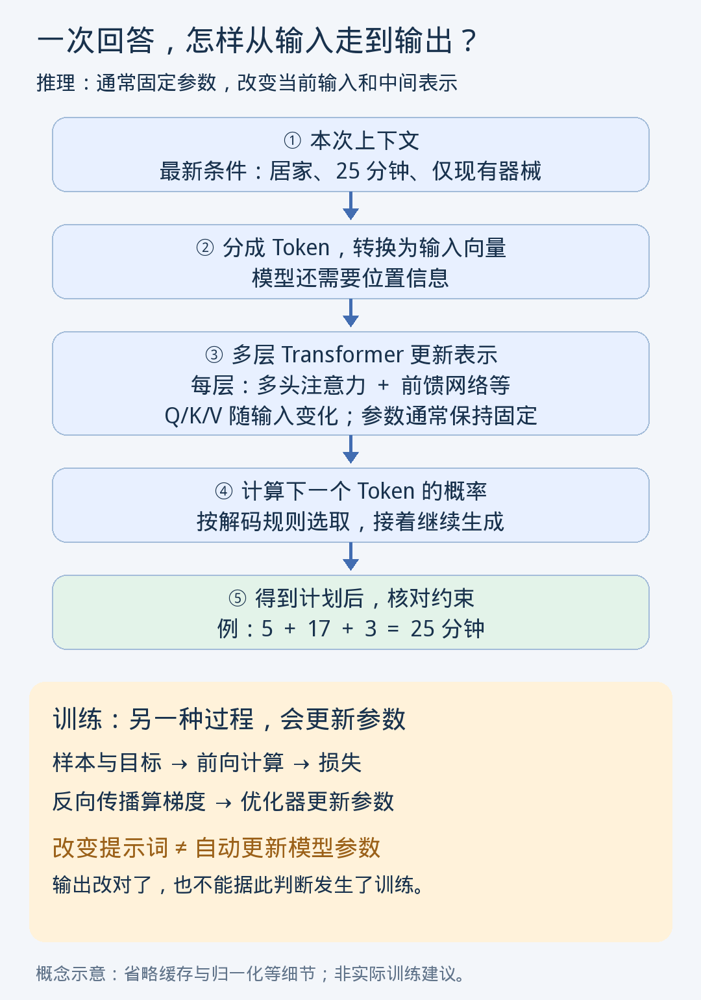

# 第7课｜改提示词与训练模型，究竟改变了什么？

日期：2026-11-04

> 归档整理版：根据当前对话可读取的课程进度摘要及问答整理，不是原始逐字讲义。教学例子不代表真实个人记录。

通过训练计划助手复习前六课。通常推理参数固定，改变上下文会改变输入与中间向量，包括 Q/K/V；训练才通过损失、反向传播和优化器更新参数。

已保存的资料不一定在当前上下文；多头各自投影完整输入，与串行的多层网络不同。逐 Token 生成不能保证约束满足。

## 教学例子
要求居家 25 分钟，输出 5+20+5=30 不合要求；调整为 5+17+3=25。仅演示约束检查，不是锻炼处方。

## 练习与参考
18 分钟居家无器械，却得到健身房器械方案，且 3+14+4=21。应明确地点、器械、总时长约束，检查合计，可修正为 3+12+3=18。纠正回答通常改变上下文，不代表模型参数改变。

状态：未见独立作答。
