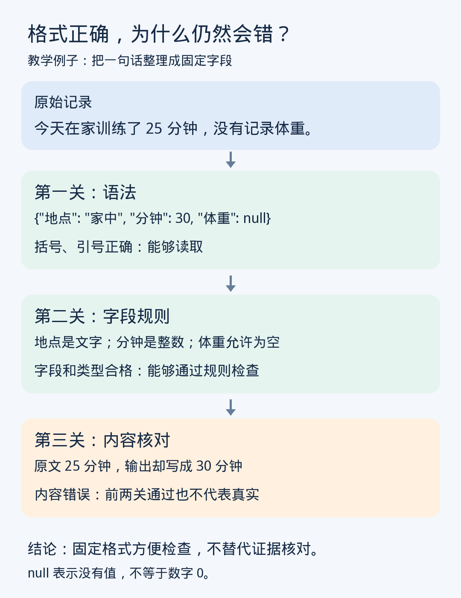

# 第8课｜提示词与结构化输出：怎样让要求更容易执行和检查？

日期：2026-11-05

> 归档整理版：根据当前对话可读取的课程进度摘要及问答整理，不是原始逐字讲义。教学例子不代表真实个人记录。

明确字段、类型、单位和缺失处理，把回答变成可校验数据。JSON 是键值等结构的表示；JSON Schema 可表达必填和类型规则。

自然语言提示不等于系统强制的结构约束；受约束解码可在生成时排除不符合规则的候选，但具体支持范围依实现而定。

三个检查层次：语法合格、模式合格、事实及业务规则正确。数字 30 可以通过数字类型检查，却不符合原文 25 分钟。

## 用户练习与反馈
用户提交提示词：用 JSON 记录日期、读书时长、页数；分钟与页数用数字，没有记录写“未记录”，不能用 0。原文为昨天读 20 分钟、今天没有读书、两天都未记页数。

反馈：字段、单位、缺失规则明确；“数字或未记录”属于联合类型。明确未读时长应为 0，而未知页数应为 null 或约定的“未记录”。“不能用 0”应限定于缺失数据；昨天/今天须有基准日期，不臆造日期。

状态：练习已提交、收到反馈，用户确认当日学习完成；不外推全面掌握。
