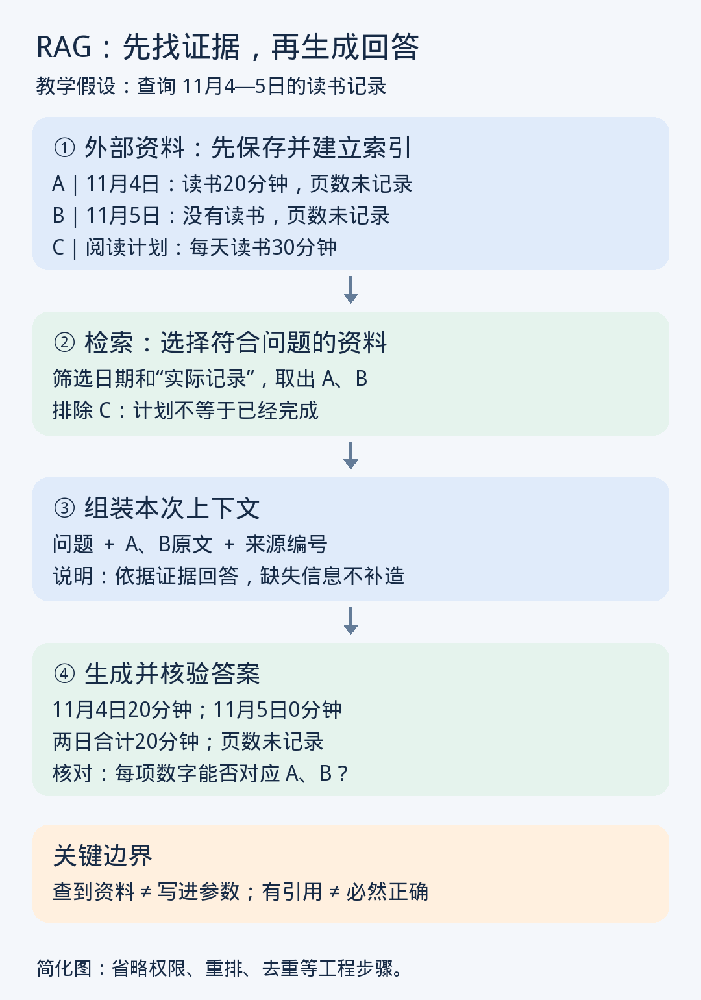

# 第9课｜RAG：怎样让模型先找资料再回答？

日期：2026-11-06

> 归档整理版：根据当前对话可读取的课程进度摘要及问答整理，不是原始逐字讲义。教学例子不代表真实个人记录。

RAG 全称 Retrieval-Augmented Generation（检索增强生成）。准备外部资料、分块索引，通过关键词或向量检索结合日期/类型筛选，取出原文与来源放入上下文，再生成并核验答案。

向量用于查找，原文提供证据。常见 RAG 推理参数固定。计划不是实际记录；top-k 相似结果不保证统计完整；未检索到不等于没发生；有引用不等于证据真的支持结论。

教学记录：11 月 4 日读 20 分钟、5 日明确未读、另一条为计划每天 30 分钟。可确认实际记录合计 20 分钟，页数未记录，不能把计划当实绩。

## 练习与实际回答
题目：1 日 10 分钟、2 日明确没读、3 日未检索到，另有每天 30 分钟计划。
用户：1 号 2 号有明确数据结论，3 号没有结论；下一步查 3 号没有数据还是没检索到。
反馈：正确。已确认合计 10 分钟，三天总量未知；即使无保存记录，也不能认定未读。
状态：练习完成，能在本案例区分确定数据与检索缺失。

## 英语与讨论
Retrieval 检索，Augmented 增强的，Generation 生成。The model retrieves relevant documents before generating an answer. 模型先检索相关文档，再生成答案。
用户要求后续英文词汇自然放在正文中，不另设背词表。当天另复习 QKV，见第四课。
