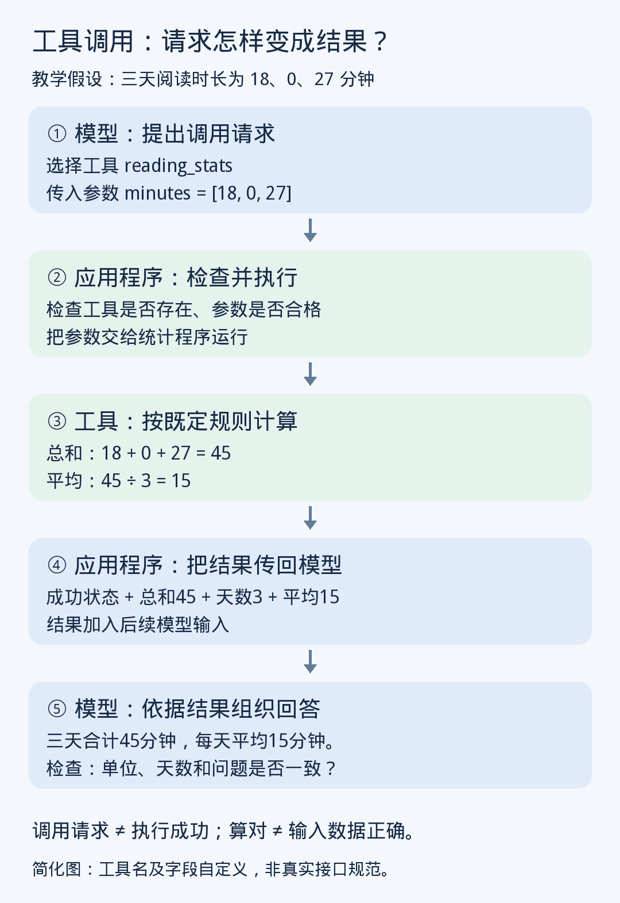

# 第10课｜工具调用：模型怎样把计算交给计算器？

日期：2026-11-07

> 归档整理版：根据当前对话可读取的课程内容及问答整理，不是原始逐字讲义。教学例子不代表真实个人记录。

工具调用（Tool calling）是一种机制：模型提出结构化请求，应用校验与路由，具体工具执行，结果回传到上下文，模型据此回答或继续行动。

## 逐步例子
虚构工具 reading_stats 接收非空数字列表 minutes，单位分钟，每项一天；明确未读记 0，未知不能擅自填 0。

```json
{"tool":"reading_stats","arguments":{"minutes":[18,0,27]}}
```

Arguments（调用参数）是本次输入，不是训练权重。Validation（校验）检查工具、类型、范围与权限；Execution（执行）由程序运行。写出请求不表示已经执行。
程序返回 Tool result（工具结果）：总时长 45、天数 3、平均 15。模型结合结果回答，通常不需更新权重。

Validate the arguments before execution. 执行前先校验调用参数。



## 常见错误
传入 [18,27] 时平均 22.5，工具没有算错，但遗漏了明确未读的一天。需同时检查输入范围、执行成功状态、最终解释。工具的精确计算不能修复错误数据。

## 练习与参考
原文 1 日 12 分钟、2 日明确未读、3 日 30 分钟；错误输入 [12,30] 得均值 21。正确三日输入 [12,0,30] 得均值 14。若第二天未记录，三日平均未知，已知两日平均 21。
用户回答缺失分支：第二天没有记录不能当零，要查证未找到还是明确未读。反馈补充查询成功但空、查询失败、明确未读的区别。未见用户独立计算 14 的证据，不外推计算题掌握。

## 课后问答：模型能力、Agent、Skill、RPC是什么关系？
- 模型：理解工具说明、选择调用、生成输入、利用结果。
- 运行程序：注册工具、校验、路由、执行、回传。
- 工具：可为产品内置、本地函数或远程服务；“外部”是相对模型推理而言。
- Skill：这里指任务操作指南，可附脚本和资料，不等于工具已经执行。
- RPC（Remote Procedure Call，远程过程调用）：一种调用远端程序的通信机制，可实现底层工具。
- Agent：根据返回结果组织连续行动；一次工具调用不要求构建 Agent。
用户复述：工具调用是一种工作机制，不特指某个具体程序。反馈正确，随后确认当日学习完成。

## 资料
- https://platform.claude.com/docs/en/agents-and-tools/tool-use/overview
- https://arxiv.org/abs/2302.04761
以上链接来自本对话此前核实的授课资料。
