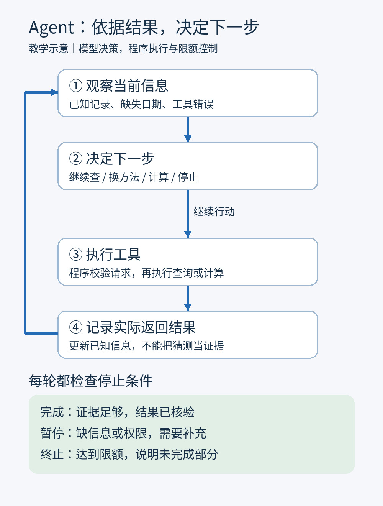

# 第11课｜Agent：怎样根据工具结果决定下一步？

日期：2026-11-08

> 归档整理版：根据当前对话可读取的课程内容及问答整理，不是原始逐字讲义。教学例子不代表真实个人记录。

Agent（智能体）在目标和规则范围内，依据工具返回结果决定下一步。本课聚焦观察—决策—行动—更新状态的循环，术语在业界并非只有一种定义。

## 类比与边界
办事助手找不到书，会查借阅记录，而不是不断回同一书架。模型也应根据反馈调整行动；它不能凭意愿获得权限，实际操作由程序执行。
Observation（观察结果）是工具返回的信息；Action（行动）是所选查询或计算。
The agent chooses its next action based on the result. 智能体根据结果选择下一步行动。

## 原理
State（状态）记录目标、已知与未知、尝试过的方法、剩余调用次数。程序存储状态，将相关内容交给模型；模型提出请求，程序执行并更新状态，再调用模型。通常模型权重不变，变化的是上下文。

## 教学示例（不是用户真实日志）
目标：统计 11 月 1—3 日每日平均。
1. 查询得 1 日 12 分钟、3 日 30 分钟；2 日未知。
2. 按精确日期补查，得“2 日没有读书”，才能记 0。
3. 工具计算 [12,0,30]，合计 42，平均 14。
4. 核验范围、重复、天数与单位后停止。
如果第二步仍无证据，则改用有希望的方法或说明缺失，不能补造 0。

## 停止与限制
Stop condition（停止条件）包括完成、阻塞需补充、预算或次数用尽。超时表示查询没有正常完成，不等于记录不存在。网络错误可有限重试；格式错误先修输入；相同结果反复返回应考虑换方法或停止。
固定程序也能循环；这里的关键是模型根据反馈动态选下一步。Agent 可混用固定规则，次数多不代表更可靠。它适合路径事先不确定的任务；已知数字求和用固定程序通常更简单。

## 练习与用户答案
题目：5 日 15 分钟、7 日 25 分钟、6 日未知；查询 6 日超时，剩一次查询。决定下一步、停止条件和最终回答。
用户：允许完成 1 次重试，因为超时可能是网络原因；无法找到记录可以停止；回答 5 和 7 号数据，明确没有找到 6 号。
反馈：有限重试、停止和报告缺失正确；仍超时应说“查询未完成，无法确认”，查询成功无匹配才说“本次未找到”。已知两日合计 40 分钟，三日平均未知；网络原因是可能性，不是确认的诊断。
若查到 6 日明确未读，三日均值才是 40/3≈13.33。

状态：用户已作答、收到反馈，并明确“今日学习完成”；不外推全面掌握。
下课：模型评估，使用测试集和评分规则判断是否稳定改进。

## 资料（授课时已核实）
- https://www.anthropic.com/research/building-effective-agents
- https://arxiv.org/abs/2210.03629
