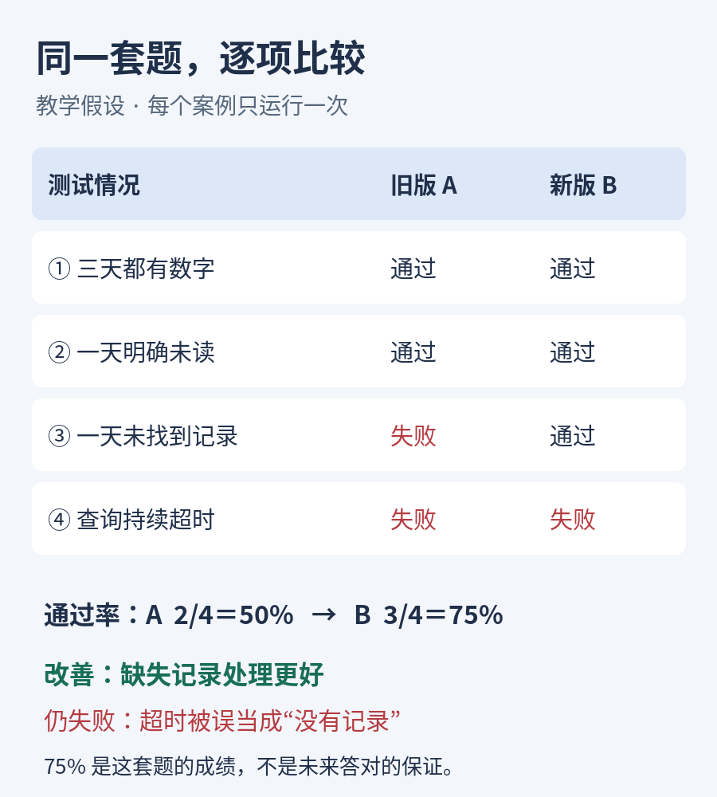

# 第12课整理笔记｜模型评估

日期：2026-11-09。完整正文见[原文](../originals/2026-11-09-12.md)。本文件为摘要，非逐字讲义。

## 核心结论与例子

用同一组测试与预先确定的评分规则比较助手版本，控制资料、工具返回、调用上限和生成设置。教学四题：完整数字、明确未读、未找到、查询超时；A通过2/4，B通过3/4；这只是本次题集成绩，不是未来正确概率。加入96道简单题使B达99/100，却没有解决超时错误。分类结果、重复运行、未参与调试的新题和回退检查共同支持评估。

术语：Evaluation评估、Test set测试集、Rubric评分规则、Metric评估指标、Regression性能回退；含正文英文例句。

## 课前讨论补记

第11课用户允许一次有理由的超时重试、必要时停止并报告已知数据，已反馈合理。再次澄清：超时是查询未完成，成功空结果才叫未找到。无新增答题证据。

## 本课练习状态

未作答。题目：20题16→18通过，但18题为普通加法，缺失/超时均失败。要求准确描述改进、补充测试或分项展示、制定超时通过条件。参考：80%→90%不代表普遍可靠；应分类评估并补题复测；额度耗尽停止、说明查询未完成、保留未知。

## 图片与来源

- https://www.anthropic.com/research/demystifying-evals-for-ai-agents
- https://arxiv.org/abs/2211.09110

下一课：第13课幻觉与证据。
