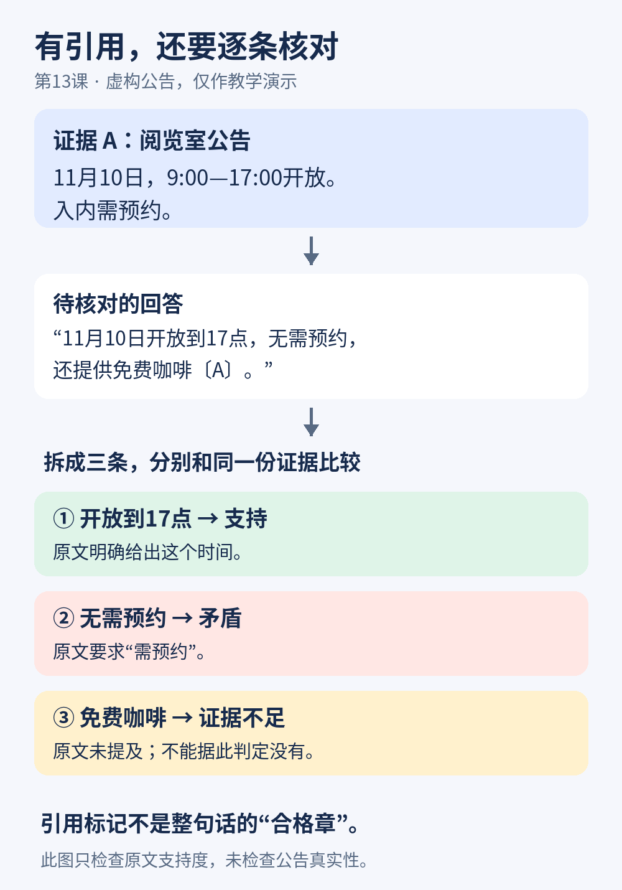

# 第13课整理笔记：幻觉与证据

日期：2026-11-10。本文为整理版，完整讲义另见[原文](../originals/2026-11-10-13.md)。

## 核心结论

- 拆分可独立核验的陈述，分别检查证据支持、矛盾或不足。
- 引用存在、来源可信且适用、来源支持陈述、回答完整，是不同检查。
- 资料相关不等于支持结论；来源未提及不能推出相反结论。
- 程序与模型可辅助核验，但核验模型也会错，保留原句便于复核。

## 例子和图片

虚构公告A：11月10日阅览室9:00—17:00开放；入内需预约。待核对回答中的开放到17点获支持，无需预约被反驳，免费咖啡证据不足。正确改写需保留预约条件，明确咖啡未知。

## 练习与讨论状态

第12课尚未见答题，无新增课后讨论。授课时尚未答题；最新答题见下节，不外推全面掌握。
本课虚构公告：11月12日14点开始、限已报名会员、时长未公布。题目要求核对14点开始/所有人参加/免费/16点结束。参考依次为支持、矛盾、证据不足、证据不足，最后两项需查证。

## 正文英文

Hallucination（幻觉）、Claim（陈述）、Evidence（证据）、Attribution（信息来源归因）。例句：The evidence supports this claim. 这份证据支持这条陈述。未见英文掌握证据。

## 来源与后续

- https://arxiv.org/abs/2305.14251
- https://arxiv.org/abs/2305.14627

以上一手资料于本次授课核实。下次第14课通过读书活动助手复习8—13课。

## 后续答题（2026-11-12整理）

用户原答：“开始时间 正确；参加资格 错误；费用 未知；结束时间 证据不足。”四项分类正确，分别对应支持、矛盾、证据不足、证据不足。分类部分已完成；未见用户独立改写最终回答，不将反馈中的示范改写算作用户作答。
