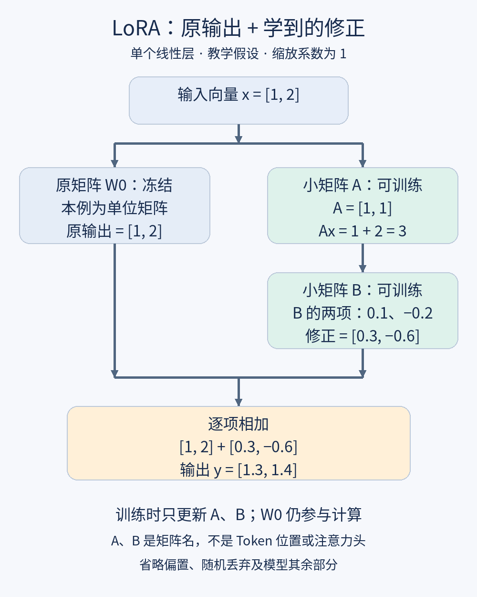

# 第16课整理笔记：LoRA

2026-11-13。完整正文见[原文](../originals/2026-11-13-16.md)。

## 核心
冻结W0，训练A/B，y=W0x+B(Ax)。此处列向量约定，不能混用之前xW的形状。低秩限制更新矩阵BA而非原权重。r控制最大独立方向和参数数目。原矩阵仍占资源，不是量化或整体模型压缩。

## 例子与图
教学假设W0单位矩阵、x=[1,2]列、A=[1,1]、B=[0.1,-0.2]列。Ax=3，修正[0.3,-0.6]，结果[1.3,1.4]。缩放1，省略偏置、dropout及其余模型。二维例A/B合计4参数不节省；1000×1000层，r8，16,000对1,000,000，可训练参数1.6%，非显存比。

## 练习状态
输入改[2,0]，Ax2，修正[0.2,-0.4]，输出[2.2,-0.4]。解释A/B更新仍算训练，增r有更多空间也更贵且效果须测。本课尚未答；第15课未见新答题，其他状态保持。

## 英文
Low-Rank Adaptation低秩适配；freeze冻结；rank秩；adapter适配器。各正文配例句，未记录为掌握。

## 资料
https://arxiv.org/html/2106.09685v2
https://huggingface.co/docs/peft/main/en/conceptual_guides/lora

下一课量化，单核心数字表示精度与资源的取舍。
