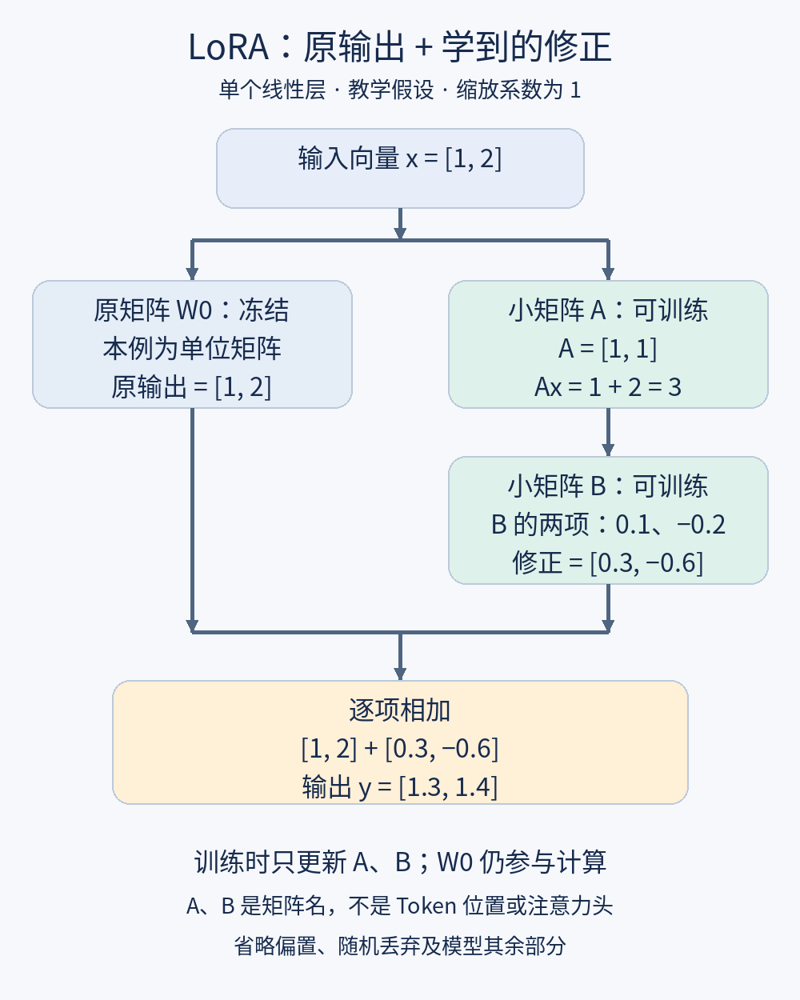

# 第16课整理笔记：LoRA

2026-11-13。完整正文见[原文](../originals/2026-11-13-16.md)。

## 核心
冻结W0，训练A/B，y=W0x+B(Ax)。此处列向量约定，不能混用之前xW的形状。低秩限制更新矩阵BA而非原权重。r控制最大独立方向和参数数目。原矩阵仍占资源，不是量化或整体模型压缩。

## 例子与图
教学假设W0单位矩阵、x=[1,2]列、A=[1,1]、B=[0.1,-0.2]列。Ax=3，修正[0.3,-0.6]，结果[1.3,1.4]。缩放1，省略偏置、dropout及其余模型。二维例A/B合计4参数不节省；1000×1000层，r8，16,000对1,000,000，可训练参数1.6%，非显存比。

## 练习状态
输入改[2,0]，Ax2，修正[0.2,-0.4]，输出[2.2,-0.4]。解释A/B更新仍算训练，增r有更多空间也更贵且效果须测。本课已提交答题，数值与概念精度反馈见下；第15课状态以PROGRESS.md为准。

## 英文
Low-Rank Adaptation低秩适配；freeze冻结；rank秩；adapter适配器。各正文配例句，未记录为掌握。

## 资料
https://arxiv.org/html/2106.09685v2
https://huggingface.co/docs/peft/main/en/conceptual_guides/lora

下一课量化，单核心数字表示精度与资源的取舍。

## 2026-11-15补入：第16课练习答题与反馈

用户原答：
> 1 a=3 b=0.3，0.6 最终结果是2.3 0.6
> 冻结不是不执行原来参数的模型，微调只是在原来结果上追加了计算
> 调整纬数，增加矩阵大小，代价计算变大，效果不能严格保证正向

纠正：输入已变[2,0]，Ax=2，不沿用旧输入算得3；B(Ax)=[0.2,-0.4]，保留负号，最终[2.2,-0.4]。A/B是矩阵名，不是中间输出。冻结仍执行的理解正确，但仅追加前向计算不等于训练，训练需损失、梯度和A/B参数更新。增加的是中间秩r，不是原输入输出维数；1000×1000层r8共16000可训练参数，r16共32000，成本增大不保证效果提高。

状态：三部分均提交；概念方向基本正确，数值已纠正，未有独立重算正确证据，不记全面掌握。
