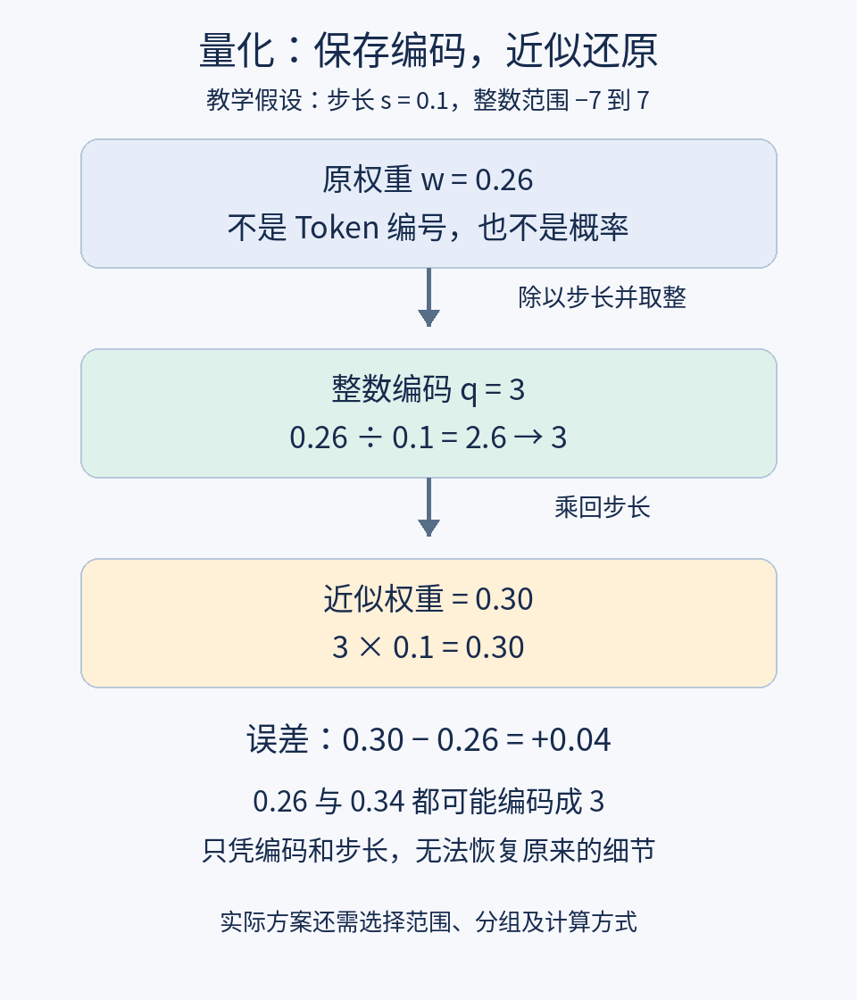

# 第17课整理笔记：量化

日期2026-11-14。完整正文见[原文](../originals/2026-11-14-17.md)。

## 核心
有限档位近似表示数值，减少权重编码位数，通常引入误差。简化零偏移均匀方案q=round(w/s)后限制范围，近似还原w_hat=sq。四位16组合，本例用-7至7共15档。量化与LoRA减少可训练参数不同。

## 教学数值
s0.1：0.26→3→0.30；-0.13→-1→-0.10；0.58→6→0.60。与输入[2,1,-1]点积，原-0.19，近似-0.10，差0.09。1.2超界限制到7还原0.7。十亿权重16位原编码2GB，4位0.5GB，十进制，不含其他开销。不能等同运行显存或速度比例。

## 练习与状态
0.34→3→0.30误差-0.04，-0.26→-3→-0.30误差-0.04；1.2超界后误差-0.5；解释4倍速度与显存推断错误。本课未答，第16课未见答题；第15课新答题已补相应笔记，独立测试例仍未完成。

## 英文与资料
quantization量化；bit比特；scale尺度；dequantization反量化，均在正文配例句。
https://huggingface.co/docs/transformers/quantization/concept_guide
https://arxiv.org/abs/1712.05877

下一课KV缓存。源码数值为教学假设，未测真实模型。
