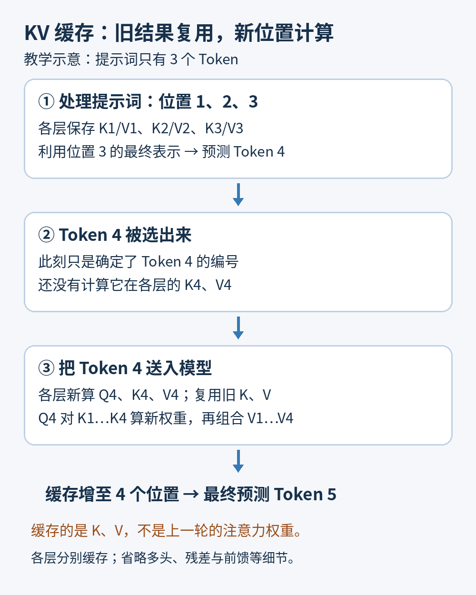

# 第18课整理笔记：KV缓存

2026-11-15。完整正文见[原文](../originals/2026-11-15-18.md)。

## 核心
因果Transformer在参数/前缀/位置条件不变时，过去各层K/V可复用。prefill处理已有提示词并缓存；decode处理新Token，各层计算新QKV，Q对旧新K计算新权重，再组合旧新V。每层缓存独立。采样Token4时缓存只有1—3；下一轮处理4后扩到4，预测5。

## 教学例子与图
单头一维V=[2,4,6,8]，假设权重[.1,.2,.3,.4]得6，非实际模型。全前缀重复位置数3+4+5=12，缓存3+1+1=5，非速度比。图省略多头、残差及FFN。

## 局限
缓存占存储，新位置仍计算并读历史；完整KV随序列增长。不是训练或永久聊天记忆、不保证正确。前缀变化不能直接复用整份缓存。

## 练习状态
4个提示Token，采样5后缓存4，处理5缓存5预测6；新Q要新权重；改开头需重算受影响部分。未见本课或第17课答题，不标掌握。第16课反馈已补对应笔记。

## 英文与来源
Key–Value cache / causal attention / prefill / decode，正文自然解释并配例句。
https://arxiv.org/html/1706.03762v7
https://huggingface.co/docs/transformers/cache_explanation
https://huggingface.co/docs/transformers/llm_tutorial_optimization

下一课多模态图片表示。
