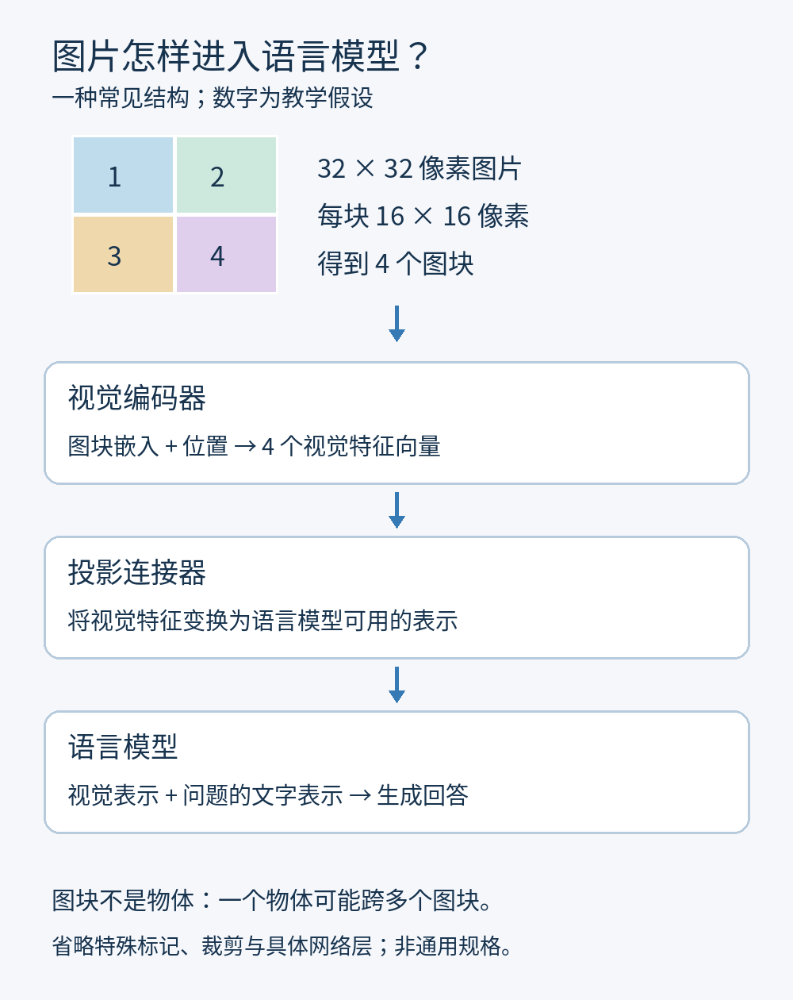

# 第19课整理笔记：图片怎样进入语言模型

2026-11-16。[完整原文](../originals/2026-11-16-19.md)。

## 核心
一种常见路线：视觉编码器+投影连接器+语言模型，不冒充所有模型通用架构。图块像素映射嵌入并加位置，视觉Transformer跨块交互，连接器将特征映射语言输入空间，与文本共同生成。不是必须先写文字描述。

## 教学例子
32×32图像、16×16图块共4块。RGB每块768数，教学嵌入8维，视觉编码输出4×8，连接器4×12。数量与维数、物体数不同；维数匹配不等于语义学好。省略特殊标记、预处理与具体层，不是产品规格。

## 练习
64×32、16×16得8块，连接器8个12维向量；图块非物体；模糊小字需清晰输入及核验，仍不清则未知。本课尚未答题。第18课用户确认阅读完成，练习未答；QKV同一概念澄清已写其笔记。

## 英文
Multimodal、patch、vision encoder、projector，正文自然例句。

## 来源
https://arxiv.org/html/2010.11929v2
https://llava-vl.github.io/
https://huggingface.co/docs/transformers/model_doc/llava

下次第20课图文对齐，第21课可综合复习15—20。
