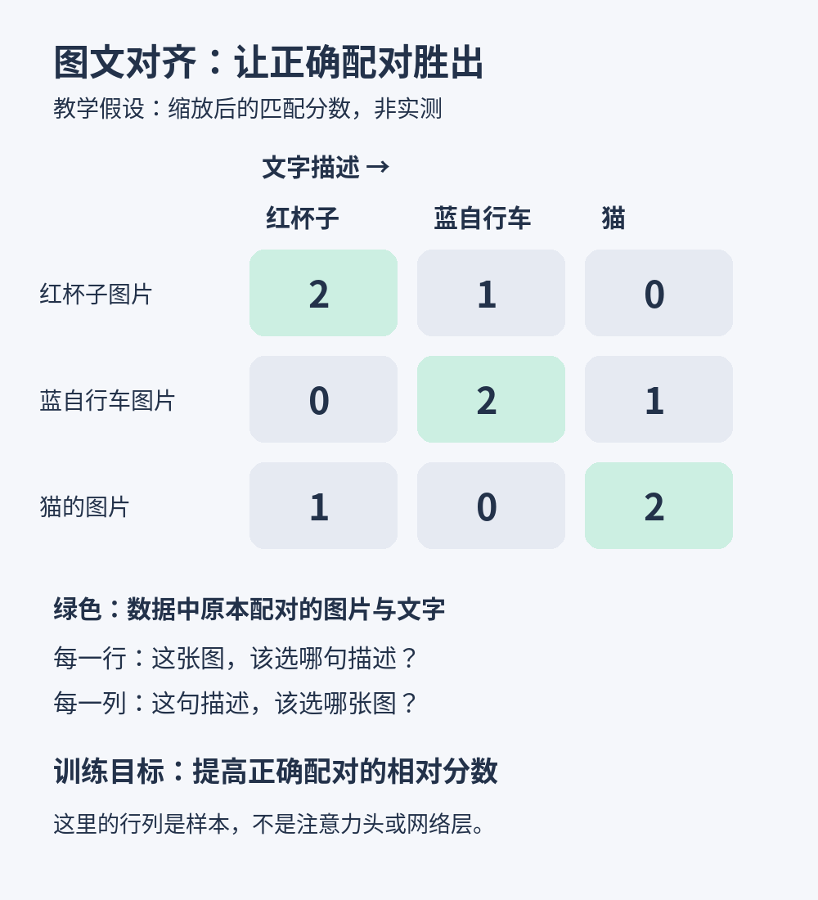

# 第20课整理笔记：图文对齐

日期：2026-11-17。本文件是整理版，全文另见[原文](../originals/2026-11-17-20.md)。

## 核心结论

CLIP式图文对比训练将图片和文字映射到可比较空间；同维数本身不保证对齐。正配对相对其他候选获高分，经Softmax和负对数损失形成训练信号；CLIP综合行列两个方向。不同于内部QKV汇总信息，也不等于完整图文对话生成器。

## 教学例子

假设缩放分数[[2,1,0],[0,2,1],[1,0,2]]，对角线为正配对。第一行正确项概率0.665，损失0.408；假设变[3,1,0]，概率0.844，损失0.170，非一次训练保证。若全部相同则1/3、损失1.10。原始余弦范围[-1,1]，表内是缩放后分数。

## 英文

alignment对齐；CLIP全称Contrastive Language–Image Pre-training；positive pair正配对；negative pair负配对；contrastive learning对比学习。全文含简短例句及翻译。

## 练习与讨论状态

练习：为红杯子设计正配对和两条易混淆负描述；解释候选仅蓝杯子/红碗时80%为何不证明匹配；区分重训与改搜索词。参考正红杯子、负蓝杯子/红碗，颜色和类别；检查结果不满足条件，扩检索；重训更新参数而通常改词不更新。尚未见用户答题，不标完成或掌握。

当前可读对话无第19课新答题。保留第18课用户阅读完成但未答练习，以及QKV误读属于助手误解而非用户缺陷的记录。

## 来源

- https://proceedings.mlr.press/v139/radford21a.html
- https://github.com/openai/CLIP

下次第21课复习15—20课。