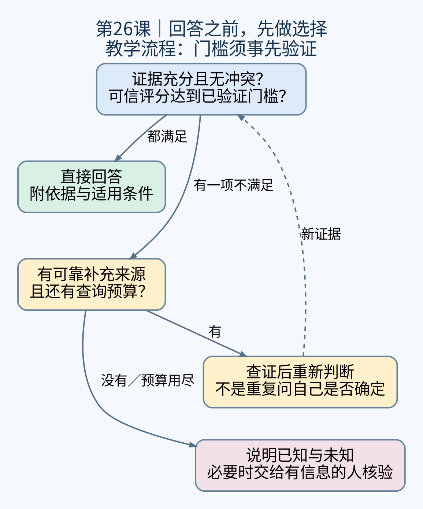

# 第26课整理笔记：选择性回答

日期：2026-11-23；完整实际讲义见[原文](../originals/2026-11-23-26.md)。

## 核心

选择性预测同时决定候选答案与放行。coverage=直接回答/总数；本课selective risk=错误/直接回答。教学20题三规则20/5、16/3、10/1（回答/错误），覆盖100/80/50%，风险25/18.75/10%。严格门槛挡掉4错也挡掉6对；零覆盖风险不可计算。分数排序有效才可能改善，独立测试、小样本与分布变化限制。查证消耗预算，不能无限循环；来源冲突不能被高分覆盖。

## 图与英文

程序绘图并目视检查。selective prediction选择性预测；abstain暂不作答；threshold阈值；coverage覆盖率；selective risk选择性风险。The model can abstain when evidence is missing.

## 讨论和练习

第25课未见新作答；第24课此前反馈保持不变，未知不可一律低分。11月22日用户再次要求后续图表辅助，26课起加强实际PNG。
第26课三题已答并收到反馈，不外推全面掌握。参考：30题甲24答3错=>80%/12.5%；乙15答1错=>50%/6.67%；风险<=10%且覆盖>=60%均不满足。改检索/排序/模型，再独立验证。0.95分但来源冲突需先核验，仍不明说明未知转有信息的人。

## 来源

https://arxiv.org/abs/1705.08500
https://aclanthology.org/2020.acl-main.503/

下一27课测试集泄漏，28课复习22—27。

## 2026-11-23用户答题与反馈

用户原答：
1 覆盖率 甲 80% 乙 50%，错误率 甲 12.5% 乙 十五分之一 ，都没有
2 优化效果，让覆盖率上升，错误率下降
3 查证

反馈：第一题全部正确，1/15约6.67%，甲风险超标乙覆盖不足。第二题提出正确目标，尚未提出具体办法；助手补充改检索以增加证据充分的题、改评分排序以区分易错题，再用独立新题核验，不保证两个指标都改善。第三题下一步正确，尚未独立说明条件；补充核对日期版本适用范围，预算内查可靠来源，仍冲突说明未知并交有信息的人，不能无限查询。记录计算正确，改进与停止条件待巩固；助手补充不记用户独立作答。
