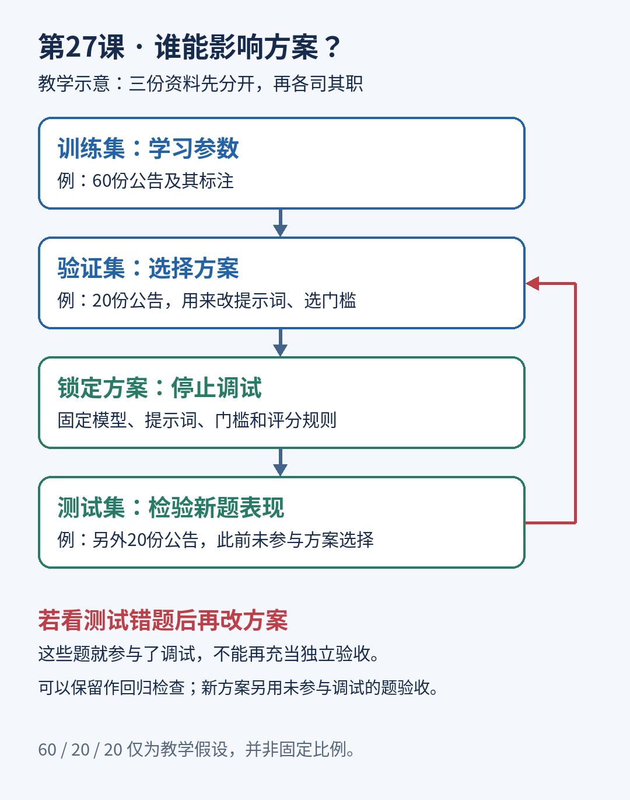

# 第27课整理笔记｜测试集泄漏

日期：2026-11-24。整理版，不替代[完整原文](../originals/2026-11-24-27.md)。

## 核心结论

- 测试是否独立取决于信息是否参与训练或方案选择。修改提示词、选择门槛也可能引入泄漏，不要求参数更新。
- training set训练集用于参数学习；validation set验证集用于选择方案；test set测试集用于锁定后最终检验。60/20/20为教学假设。
- 同一原活动的改写问题应分组划分，避免以同源熟题评估新活动处理能力。
- 测试分析可以用于下一轮开发，但旧题不再是新版本的独立验收；可保留作回归检查。

## 关键例子与图片

20道旧题14对→按错题修改提示词→18对；旧题90%不能直接代表新题准确率。假设新20题13对=65%，不能仅凭小样本与不同题目成绩断言变差或泄漏导致全部差异。比较版本须同一独立新测试集与相同条件。

## 可读答题与讨论衔接

第26课三题已答并获反馈，详见该课笔记：80%/12.5%、50%/1/15均正确；均未同时达标正确；提高覆盖降低错误是目标，查证是正确下一步。具体改进方法与查证停止条件由助手补充，不能记录为用户独立完成。

本课练习30道测试反复修改10轮提示词28对及同源改写跨组，要求识别泄漏、限定成绩含义、设计20份新公告验收。尚未作答。

## 资料

- https://scikit-learn.org/stable/common_pitfalls.html#data-leakage
- https://scikit-learn.org/stable/modules/cross_validation.html
- https://arxiv.org/abs/1506.02629

下一课28综合复习22—27。维持每日9点长期学习，不改变既有任务。
