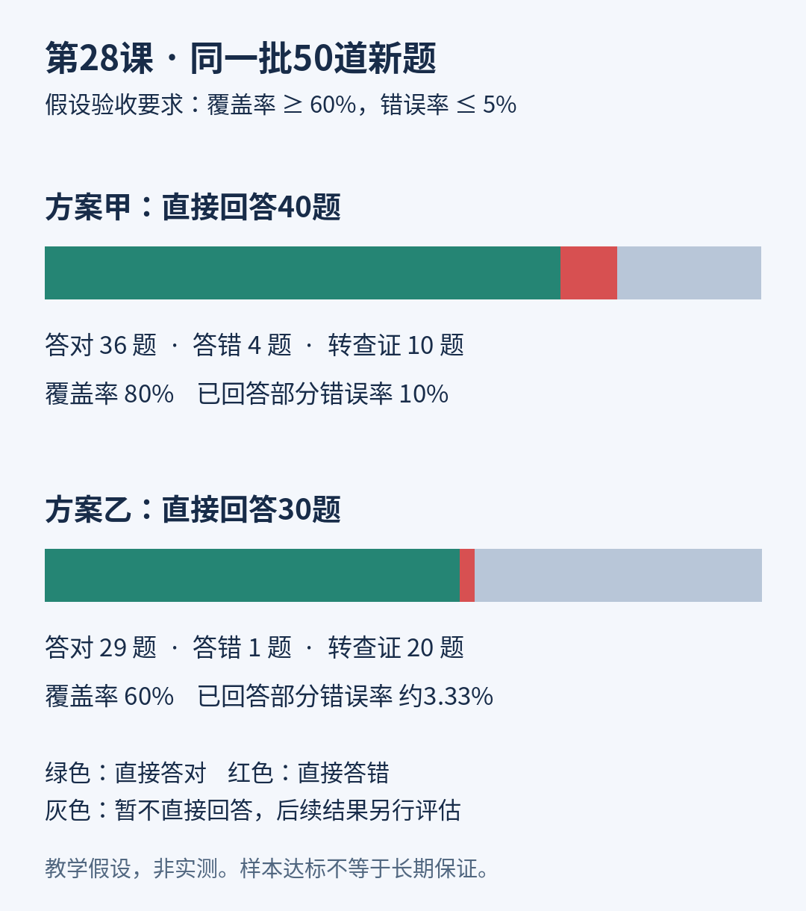

# 第28课整理笔记｜上线验收综合复习

日期：2026-11-25。整理版，另存完整原文。

## 核心与例子

核心：从目标、评分到独立测试，形成范围明确可复查的验收结论。复习22—27课，教师错误可传递、偏好奖励不等于事实正确、未知按证据判断、校准不自动改正答案、覆盖率和风险及后续处理分开统计、独立测试防泄漏。

教学50题：甲直接答40，其中错4，正确36，转查证10；覆盖80%，风险10%。乙30答1错29对，转查证20；覆盖60%，风险约3.33%。假设要求60%及5%，乙在样本上达标，非长期保证。另一批置信度题10题报90%7对=70%，高估20个百分点；该批与50题独立，不混合计数。

## 讨论与状态

27课三题完成，补同源跨组及10题小样本限制，已更新对应笔记与进度。24课未知不一律低分，26课双指标与查证停止继续复习。23、25未见新答题。

28课练习40题28答2错，覆盖70%、风险约7.14%不同时达标；其中10题90%8对，仅修改概率不修复答案；提示词修改后旧题回归、新题验收。未见作答，不记掌握。

## 资料与后续

https://arxiv.org/abs/1503.02531
https://arxiv.org/abs/1706.04599
https://scikit-learn.org/stable/modules/cross_validation.html

下一29课重排序。维持长期每日学习。
