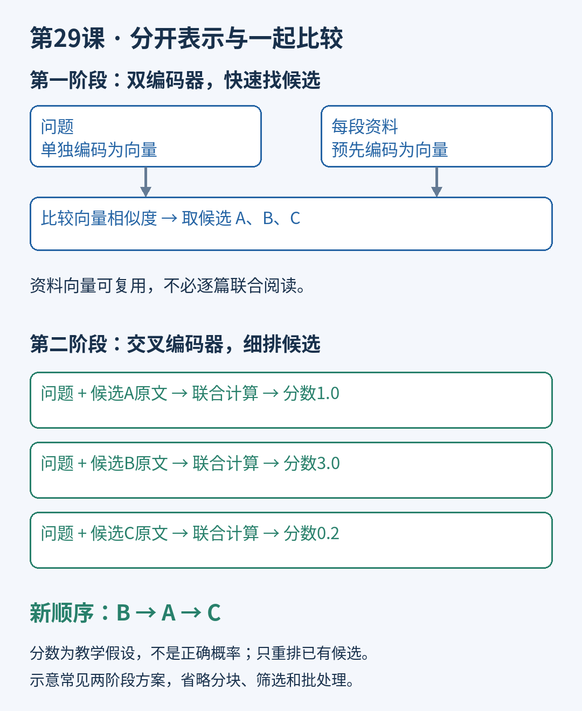

# 第29课整理笔记：重排序
日期：2026-11-26。此为整理版，完整授课正文见[原文](../originals/2026-11-26-29.md)。

## 核心结论
先快速检索候选，再联合问题与候选原文评分。双编码器分别编码，可共享参数，资料向量可预计算；交叉编码器联合输入，注意力跨问题和原文交互，输出相关性分数。训练需相关性标注、损失和参数更新；日常重排一般仅推理。

## 教学例子
虚构星河读书会11月30日非会员资格。A报名及地点、B明确会员和非会员均可提前登记报名、C会员积分。初次相似度0.88/0.82/0.79；重排分数1.0/3.0/0.2；A→B→C变为B→A→C。数值非实测，两种评分不可直接比较，不表示正确概率。百万段检索100再给生成5是设计示意，不保证速度比例。

## 英文
reranking重排序；candidate候选项；bi-encoder双编码器；cross-encoder交叉编码器。
The reranker puts the most relevant passage first. 重排序模型把最相关的段落放在最前面。

## 局限与验证
候选没有答案须改善检索；分数不代表来源真实、最新、适用；全部无关仍有第一名。固定候选比较前几名答案资料命中和耗时，最终用独立测试测回答质量。

## 练习及状态
旧公告16:00、新公告16:30、报名说明：优先新公告并核对活动身份、来源和更晚更新；新公告缺失时须补检索；0.96非事实概率。2026-11-26用户已答三题并反馈，记练习完成，不外推全面掌握。
第28课已于11月26日答题并反馈；第27课已答及反馈已归档，无需重复更新，未改其原文及PNG。

## 来源
- https://www.sbert.net/examples/sentence_transformer/applications/retrieve_rerank/README.html
- https://arxiv.org/abs/1901.04085
核实日期2026-11-26。下一第30课混合检索。

## 2026-11-26答题反馈（11月27日补记）
用户答：选B并看时效性；A/C无答案，需优化最初检索；分数只为排序非准确率。核心判断均正确。补充核对来源、同一活动与更晚更新；候选缺失先查是否入库再查检索；0.96衡量相关程度，非事实正确概率。未修改原讲义或PNG。
