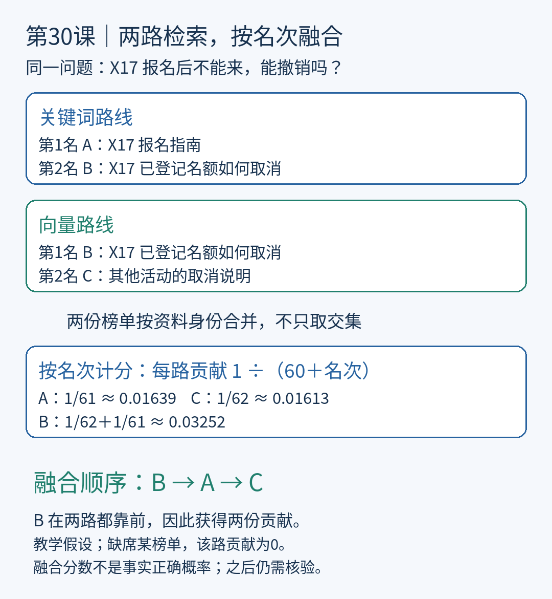

# 第30课整理笔记：混合检索
日期2026-11-27。整理版，全文见originals。

核心：两路分别找候选，按资料身份合并并融合，不只取交集。词项检索抓编号原词，向量联系不同说法，优势需实测；编号等约束应筛选或校验。

RRF全称Reciprocal Rank Fusion，倒数排名融合。各路贡献1/(60+名次)，不在返回名单贡献0；名次从1，60非候选数量，非所有任务最优。丢弃原始分差距，不同评分尺度不用直接相加。

教学虚构X17报名取消：关键词A/B，向量B/C。A=1/61=.01639，B=1/62+1/61=.03252，C=1/62=.01613，B/A/C。图中原文身份A报名指南，B已登记名额如何取消，C其他活动取消说明。未加入编号严格过滤。融合分非正确概率。

混合扩展候选，交叉编码器可随后细排；未入库或两路均漏掉不能融合补回。独立测试同最终候选数，比较答案资料命中、耗时、最终答案。

英文Hybrid search混合检索、Lexical search词项检索、Vector search向量检索、RRF；例句Hybrid search combines keyword and vector results.

练习关键词D/E向量F/E，E2/62=.03226，D/F1/61=.01639；F只一路非删除理由，但X18不满足X17须排除；两路缺失须查入库、编号、词项、查询和候选数。未见用户作答，不记完成。

28/29课答题及准确反馈已补对应笔记与进度，原文与旧PNG不改。

来源（2026-11-27核实）：
https://learn.microsoft.com/en-us/azure/search/hybrid-search-overview
https://www.elastic.co/docs/reference/elasticsearch/rest-apis/reciprocal-rank-fusion
https://learn.microsoft.com/en-us/azure/search/hybrid-search-ranking

下一31课文档分块。
