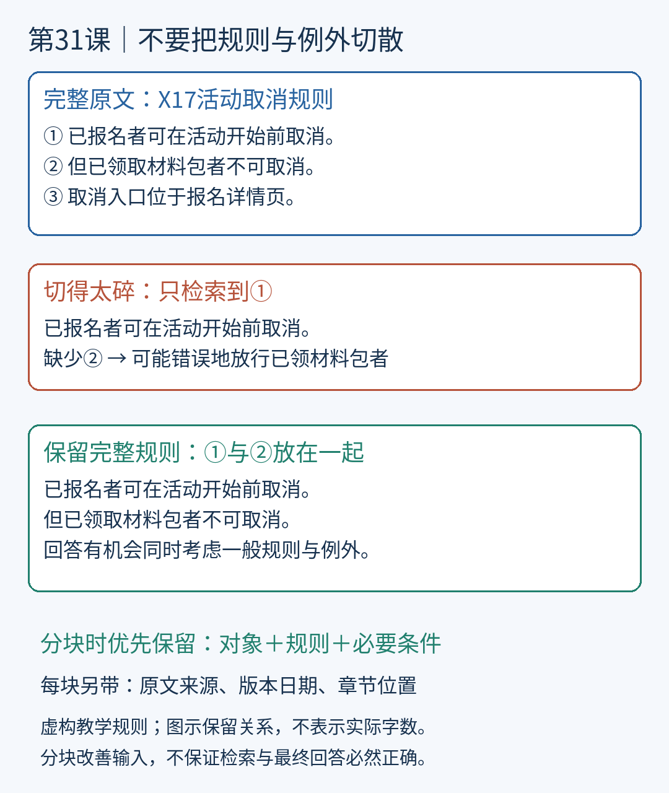

# 第31课整理笔记：文档分块
日期：2026-11-28。整理版；完整原文另存originals与raw。

核心：选择可检索且保留完整证据的文本单位，兼顾输入成本。切碎会丢对象、例外与代词指向；过长可能混合主题、占输入预算或超限截断，并非所有长块都差。

虚构X17规则：已报名者可在开始前取消；已领材料包者除外；入口在报名详情页。对象与①②应保留在一起，短公告可含③整段保存。常见一块一向量为本课假设；chunk非Token，分块非摘要/删原文/训练模型参数。

长文计算假设：1200 Token，chunk size 400、overlap 100，步长300。1—400/301—700/601—1000/901—1200，总1500个位置重复计入，比原文多300，不等于总成本同比增加。390—430条件在第二块完整；重叠不能保证找回远处条件，也不是独立证据。

metadata来源/日期/章节位置辅助筛选追溯，未知日期不造；必须进入需要的检索或回答环节。按标题段落句子先拆，中文考虑句号；长度须区分字符与Token。评估用独立题，相近最终上下文预算，比较必要证据、答案、耗时，不能只固定块数。

英文：chunking分块、chunk文本块、metadata元数据、chunk size块大小、overlap重叠。例句Overlap preserves context across boundaries.（重叠保留跨越边界的上下文。）

练习：Y08发货前可取消但定制商品除外；设计完整块。固定窗口300重叠50，第二块251—550。重复的一般规则不能替代缺失例外，回查原文。用户尚未答题，不记录为掌握。

第30课三题与准确反馈已补对应整理笔记和PROGRESS；旧原文/raw/PNG不变。

来源（2026-11-28核实）：
https://learn.microsoft.com/en-us/azure/search/vector-search-how-to-chunk-documents
https://docs.langchain.com/oss/python/integrations/splitters/recursive_text_splitter

下一第32课《父子分块：为什么可以小块检索、大块阅读？》。
