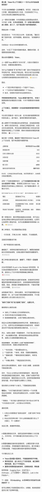

# 第二课｜历史课程截图（文字待核对）

> 本文件保存用户提供的课程截图，不是全文转录，也不是重新生成的讲义。

- 对应课程：第2课《Token与上下文窗口：为什么长对话会漏掉信息？》。
- 课程日期：2026-10-30（依据已确认课程进度，不从截图推测）。
- 来源：用户上传1000009479.jpg，收到尺寸120×1536像素。
- 处理：仅裁出第二课正文区域（原图x=0—120、y=75—1450），移除顶部界面及后续聊天片段，保存为120×1375像素PNG。未重绘、锐化或补写文字。
- 归档状态：课程截图已保存；小字分辨率不足，完整文字原文仍待核对。已有的[两分钟复习](2026-10-30-02-review.md)继续单独保存。
- 后续补齐：取得清晰原图、分段截图或复制正文后，再保存可核对的全文；不使用课程摘要补写模糊文字。

[查看课程截图](../assets/lesson-02-course-screenshot.png)

