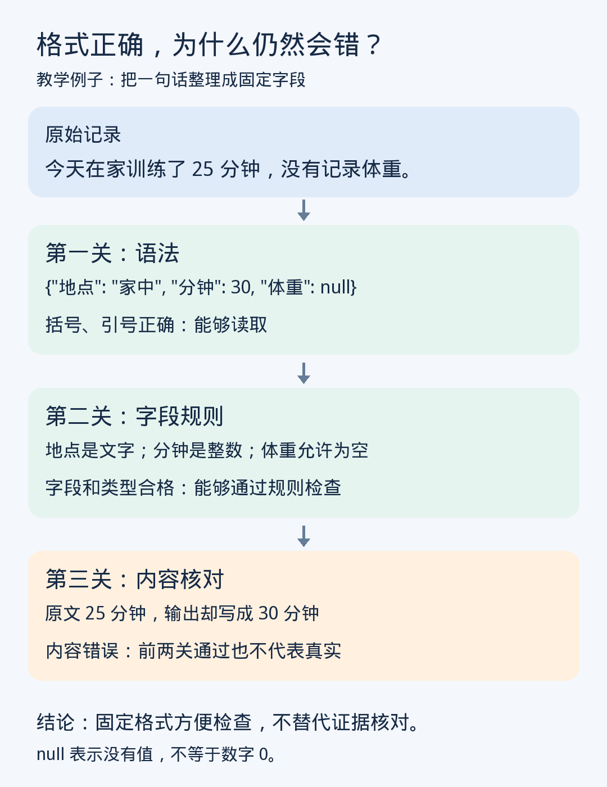

# 第八课｜提示词与结构化输出：怎样让要求更容易执行和检查？

> 归档说明：本课全文来自用户本次粘贴的历史讲义。[原始粘贴文本](raw/2026-11-05-08.md)独立保留。此阅读版仅调整标题、表格、强调与公式排版，移除界面耗时行（如有），保留原措辞、例子、练习和参考资料。图片接回此前已归档的本课 PNG。本次补档不表示重新授课或完成练习。

2026 年 11 月 5 日 · 阅读约 8 分钟，练习约 2 分钟
 
上一课区分了“改变上下文”和“更新参数”。今天进一步学习：**怎样把一段自由回答，变成能逐项检查的数据。**目前未见你提交上一课练习，因此先继续讲解，不把相关知识记为已掌握。
 
## ① 一个问题：回答看着清楚，为什么还是难整理？
 
假设你让 AI 整理一段记录：
 
> 今天在家训练了 25 分钟，没有记录体重。

 
它可能回答：“今天完成了不错的居家训练，持续约半小时。”
 
读起来自然，但出现了两个问题：25 分钟变成了“约半小时”；体重没有记录这件事被省略了。
 
如果每天措辞都不同，月底统计就很麻烦。我们需要的不是更多修饰，而是固定回答几个问题：地点是什么？多少分钟？体重有没有记录？
 
这就是**结构化输出（structured output）**的用途：按照事先规定的字段和格式组织结果。
 
## ② 类比：让 AI 填表，而不是自由写作文
 
表格会规定“日期”“地点”“分钟数”等栏目，让信息有固定位置。结构化输出也类似。
 
其中，**字段**就是栏目名称；**类型**说明这个栏目应填文字、数字，还是其他形式。
 
但类比有边界：表格只能规定哪里填什么，不能保证填写者没有看错。AI 完全可能在“分钟数”一栏填入一个格式正确、内容错误的数字。
 
今天始终记住这三层区别：
 

 
## ③ 逐步演示：把一句话变成可检查的记录
 
以下都是教学假设，不代表你的实际训练记录。
 
**第一步：明确任务与信息来源。**
 
原提示只有“帮我整理一下”，模型需要自行决定整理哪些内容、是否补充解释。
 
可以改成：
 
> 仅从下面的记录提取信息，不增加原文没有的事实。记录：今天在家训练了 25 分钟，没有记录体重。

 
“仅提取”把任务范围缩小了：这里是在整理记录，不是在生成训练建议。
 
**第二步：定义字段，以及缺失值怎么处理。**
 

|字段|要求|
|---|---|
|地点|文字；未提及则为空|
|分钟|整数，单位为分钟；未提及则为空|
|体重千克|数字，单位为千克；未提及则为空|
 
为什么专门规定缺失值？因为**没有记录，不等于数值为零**。体重写成 0，会被后续统计当成真实测量值；留空则表达“这里没有数据”。
 
**第三步：用一种固定格式表达。**
 
一种常见格式叫 **JSON**，可以把它理解为“带栏目名称的数据卡片”：
 
```json
{
  "地点": "家中",
  "分钟": 25,
  "体重千克": null
}
```
 
不用编程也能读懂：
 
- 冒号左侧是名称，右侧是值。
- `"家中"` 带引号，表示文字；`25` 不带引号，表示数字。
- `null` 表示没有值；这里按我们的约定，表示原文未提供。

 
**第四步：给这张卡片制定检查规则。**
 
**JSON Schema（JSON 模式）**是一种描述数据规则的方式，可以规定有哪些字段、哪些必填、每个字段允许什么类型。
 
例如，“分钟必须是整数或空值”“地点必须出现”。注意：定义了一个字段，不代表它自动成为必填项，需要另外声明。
 
这些规则让程序能发现“漏了地点”“分钟写成了文字”等问题，而不必先读懂整段自然语言。
 
## ④ 为什么有效：说明要求与限制生成，是两回事
 
在普通对话里说“请只输出 JSON”，本质上仍是向模型提供指令。它影响模型接下来生成什么，但模型仍可能添加解释、漏字段或写错格式。
 
另一种机制是**受约束解码（constrained decoding）**。“解码”就是根据模型的预测选择后续 Token；“受约束”则是在选择时，把不符合当前格式规则的候选排除。
 
假设某字段只允许“居家”或“健身房”，生成系统可以限制后续输出只能完成其中一个合法选项，而不是任意地点文字。实际实现会跟踪生成进度，并处理词语可能拆成多个 Token 的情况。相关研究展示了用形式化规则引导生成、约束输出结构的方法。
 
所以，两者的区别是：
 
> **提示词说明“希望怎样回答”；受约束解码限制“哪些输出在格式上被允许”。**

 
这并不需要在每次回答时训练参数。它可以发生在生成阶段。具体系统支持哪些规则，要看实现，不能把普通聊天中的格式请求当成已经启用了严格约束。
 
## ⑤ 最重要的局限：格式正确，不等于内容正确
 
回到图中的错误结果：
 
```json
{
  "地点": "家中",
  "分钟": 30,
  "体重": null
}
```
 
它的括号、引号都正确；分钟也是整数。但原文明明写了 25。
 
因此，检查至少分三层：
 

|检查|回答的问题|
|---|---|
|语法检查|这段数据能否被读取？|
|模式检查|字段、类型、允许值是否符合规则？|
|内容检查|数值是否符合原文和实际任务要求？|
 
例如，“各段时间相加必须等于总时长”，需要另外核算。让模型自己写一句“检查通过”，也不等于已经独立验证。
 
结构化输出适合整理日志、提取资料、分类反馈、向后续程序传递信息。它让错误更容易暴露，却不会自动提供缺失的证据。自由写作和开放讨论则未必需要固定字段。
 
## ⑥ 两分钟开放式练习
 
给你一段原始记录：
 
> 昨天读书 20 分钟。今天没有读书。两天都没有记录阅读页数。

 
AI 整理今天的数据，写成：
 
```json
{
  "阅读分钟": 20,
  "阅读页数": 0
}
```
 
请完成两件事：
 
1. 改写一条提示，说明提取哪一天、需要哪些字段，以及未知信息如何处理。
2. 指出两个数值分别哪里有问题，并写出修正结果。

 
先独立想一想，再看参考。
 
***
 
**参考思路**
 
可以要求：“只提取今天的记录；输出阅读分钟和阅读页数；明确没有进行的活动记为 0，未记录的数据用 null，不沿用昨天的数值。”
 
修正结果是：
 
```json
{
  "阅读分钟": 0,
  "阅读页数": null
}
```
 
分钟数 20 来自昨天，日期混用了；页数 0 则把“未记录”误写成了确定数字。按本题的提取规则，不能用推测替代缺失记录。正式长期记录还应保存具体日期，必要时附上对应原文，方便追溯。
 
## ⑦ 今天记住三条
 
1. 结构化输出把回答变成固定字段，方便读取、比较和检查。
2. 提示词与受约束解码作用不同，不能把“要求格式”当成“强制格式”。
3. 语法合格、字段合格、内容正确，是三个不同层次。

 
**下次第九课：《RAG：怎样让模型先找资料再回答？》**我们会解决今天剩下的问题：格式有了，可靠内容从哪里来？
 
本课核实资料：
 
- [JSON Schema 官方文档：对象、字段与必填规则](https://json-schema.org/understanding-json-schema/reference/object)
- [原始论文：Efficient Guided Generation for Large Language Models](https://arxiv.org/abs/2307.09702)
