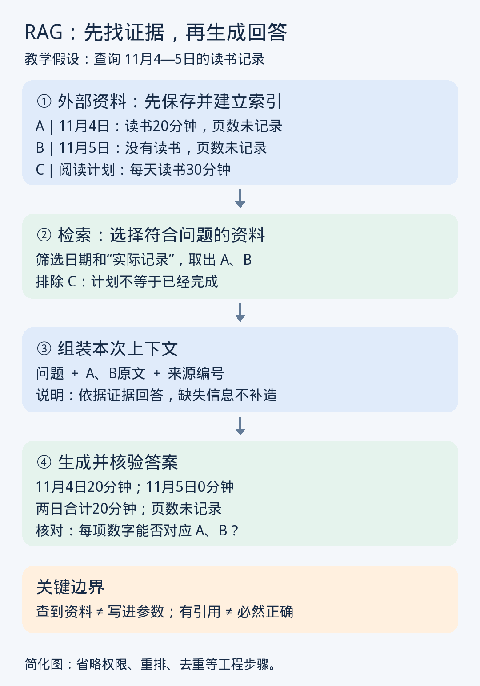

# 第九课｜RAG：怎样让模型先找资料再回答？

> 归档说明：本课全文来自用户本次粘贴的历史讲义。[原始粘贴文本](raw/2026-11-06-09.md)独立保留。此阅读版仅调整标题、表格、强调与公式排版，移除界面耗时行（如有），保留原措辞、例子、练习和参考资料。图片接回此前已归档的本课 PNG。本次补档不表示重新授课或完成练习。

2026 年 11 月 6 日 · 阅读约 8 分钟，练习约 2 分钟
 
昨天你已经提交了结构化输出练习：明确日期、字段、单位，并要求缺失信息写“未记录”。今天继续解决一个更前面的问题：**用来填写这些字段的资料，从哪里来？**
 
学完这一课，你能说明 RAG 的工作流程，并区分“没有找到记录”和“记录明确没有发生”。
 
## ① 场景：资料存着，模型为什么还是不知道？
 
假设你保存了一整年的读书记录，然后问：
 
> 11 月 4 日到 5 日，我总共读了多久？

 
模型不能仅凭训练时学到的通用知识，知道你的私人日志；把文件保存下来，也不等于每次回答时都完整读取了它。
 
可以先从资料中找到相关记录，再交给模型组织答案。这种方法叫 **RAG：Retrieval-Augmented Generation，检索增强生成**。
 
三个词分别对应：**查找资料、补充回答依据、生成答案**。经典 RAG 研究将外部检索到的文本与语言模型结合，用于回答知识密集型问题。
 
## ② 类比：开卷考试，但有人先替你找页码
 
可以把模型类比为参加开卷考试的人：遇到问题，先翻到相关页面，再依据页面作答。
 
这里有两个不同的工作：
 
- **检索器**负责找出可能有用的资料。
- **生成模型**负责结合问题和资料，组织回答。

 
类比的边界是：检索器可能翻错页、漏掉关键页；模型也可能读错。允许查书，并不等于考试必然满分。
 
而且，常见 RAG 系统在回答时可以保持模型参数不变。**资料进入的是本次上下文，并不因为被读到，就自动写进模型参数。**
 
## ③ 一张图，看清资料怎样进入回答
 
下面沿用读书场景，但所有记录都是教学假设，不是你的真实日志。
 

 
**第一步：先把资料整理成可查找的形式。**
 
假设资料库里有三条内容：
 

|编号|类型|内容|
|---|---|---|
|A|实际记录|11 月 4 日读书 20 分钟，页数未记录|
|B|实际记录|11 月 5 日没有读书，页数未记录|
|C|阅读计划|每天计划读书 30 分钟|
 
长文档通常会切成较小片段，这叫 **分块（chunking）**。系统再建立**索引（index）**，也就是帮助快速查找内容的数据结构。
 
片段还应保留日期、来源、记录类型等附加信息，称为**元数据（metadata）**。否则一句“读了 20 分钟”被单独取出后，可能无法判断是哪一天。
 
分块也不能只顾切短。如果把“11 月 5 日”与“没有读书”拆散，就可能破坏原本的含义。
 
**第二步：根据问题，检索相关资料。**
 
查询“11 月 4—5 日读书多久”时，可以结合：
 
- 日期筛选，限定这两天；
- 关键词匹配，寻找读书记录；
- 向量相似度，寻找表达不同但意思相关的内容。

 
这与第三课的 Embedding 接上了：检索系统把问题和文本映射到兼容的向量空间，比较相似程度。比如“阅读耗时”与“读了多久”措辞不同，也可能匹配。
 
但“每天计划读书 30 分钟”同样很相关，所以还要区分**计划与实际记录**。关键词、向量检索和筛选条件可以配合使用；上下文有限，也要求系统选择相关片段，而非把所有文件直接塞进去。
 
**第三步：把找到的原文放进上下文。**
 
一个常见实现会给生成模型这样的输入：
 
> 问题：11 月 4—5 日总共读书多久？
> 资料 A：11 月 4 日读书 20 分钟，页数未记录。
> 资料 B：11 月 5 日没有读书，页数未记录。
> 要求：只依据资料回答，标明来源；无法确定的内容说明缺失。

 
这里容易混淆的一点是：**检索向量帮助找资料，找到的原文片段才提供可阅读的证据。**不是把一个相似度分数直接当成答案。
 
**第四步：生成答案，再核对证据。**
 
合理回答是：
 
> 11 月 4 日读书 20 分钟〔A〕，11 月 5 日为 0 分钟〔B〕，两日合计 20 分钟。阅读页数未记录。

 
其中 A、B 是这个教学资料库中的来源编号。
 
检查时要逐项核对：20 是否来自 A？0 是否由 B 的明确陈述支持？是否把计划 C 混进了实际时长？
 
## ④ 为什么有效，又为什么仍会错？
 
RAG 的价值，是让模型在回答时获得与当前问题直接相关、可以追溯的资料。更新外部资料及对应索引，也能让后续回答使用新内容，而不必每次都重新训练生成模型。
 
但它至少有两个独立的失败位置：
 

|失败位置|具体例子|
|---|---|
|检索阶段|只找到计划 C，漏掉实际记录 A、B|
|生成阶段|已经提供 A、B，模型仍误写成每天 30 分钟|
 
这决定了改进方向。检索漏了资料，需要检查索引、查询、筛选和资料覆盖；资料已经正确提供，却被误读，则要检查生成要求和答案核验。
 
**有引用也不代表正确**：模型可能引用 A，却写出 A 不支持的数字。引用提供了核对入口，核对工作仍然必要。
 
## ⑤ 一个特别重要的局限：相似结果不等于完整记录
 
检索常会取前几个最相关结果，称为 **top-k**，其中 k 是数量。
 
但如果问题是“整个月总共读书多久”，只找出最相关的五条记录，不能代表已经找齐整个月。
 
这类统计应按日期取全记录、检查缺漏，再计算总和。资料本来就是结构化表格时，直接筛选表格、进行统计，往往比依靠语义相似度挑几段文字更合适。
 
RAG 适合文档问答、学习笔记查询、内部手册检索；它不等于联网搜索，也不保证资料是最新版本，更不意味着系统可以访问所有私人文件。
 
## ⑥ 两分钟小练习
 
你问：“11 月 1—3 日，我总共读书多久？”
 
系统检索到：
 
- A：11 月 1 日，读书 10 分钟。
- B：11 月 2 日，明确没有读书。
- C：阅读计划，每天读书 30 分钟。
- 11 月 3 日：未检索到记录。

 
请写出一段回答，说明：目前能确认什么、不能确认什么，以及下一步应该查什么。可以使用自然语言，也可以用你昨天练习过的 JSON。
 
***
 
**参考思路**
 
目前只能确认：11 月 1 日为 10 分钟，11 月 2 日为 0 分钟，**已找到的实际记录合计 10 分钟**。
 
三天总时长暂时无法确定，因为 11 月 3 日未检索到记录。不能把它补成 0，也不能用每天 30 分钟的计划代替实际情况。
 
下一步应针对 11 月 3 日继续查询，检查记录是否存在、是否进入索引、是否被筛选条件漏掉。即使最终确认没有保存记录，也仍不等于那天没有读书。
 
## ⑦ 今天记住三条
 
1. RAG 把外部资料检索出来，放入上下文，帮助模型生成有依据的回答。
2. 找到相关资料、找齐必要资料、正确使用资料，是不同要求。
3. 未检索到不等于没发生；有来源编号也不等于答案已被证实。

 
**下次第十课：《工具调用：模型怎样把计算交给计算器？》**资料找齐以后，我们继续看怎样让外部工具完成计算。
 
本课核实资料：
 
- [RAG 原始论文：Retrieval-Augmented Generation for Knowledge-Intensive NLP Tasks](https://arxiv.org/abs/2005.11401)
- [Microsoft 官方文档：检索增强生成及其挑战](https://learn.microsoft.com/en-us/azure/search/retrieval-augmented-generation-overview)
