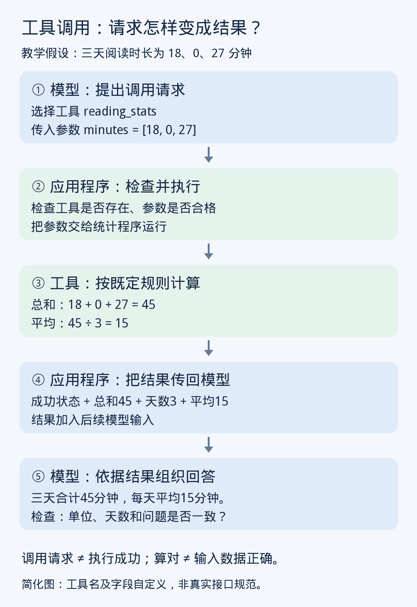

> 归档说明：保留原授课正文，仅将图片路径和聊天引用标记转换为 GitHub 可用链接。未经转换的消息文本见 [raw/2026-11-07-10.md](raw/2026-11-07-10.md)。此说明不属于原讲义。

**第十课｜工具调用：模型怎样把计算交给计算器？**  
2026 年 11 月 7 日 · 阅读约 8 分钟，练习约 2 分钟

昨天你完成了 RAG 练习，也复习了 Q/K/V：每个位置产生自己的 Q、K、V，用 Q 匹配可见位置的 K，再加权汇总 V。

今天走到模型之外：**模型怎样请求一个程序做事，再利用程序返回的结果回答？**这叫**工具调用（Tool calling）**。

**① 资料找齐之后，谁来算？**

假设检索已经找齐三天的阅读记录：

| 日期 | 阅读时长 |
|---|---:|
| 11 月 1 日 | 18 分钟 |
| 11 月 2 日 | 明确没有读书，即 0 分钟 |
| 11 月 3 日 | 27 分钟 |

你问：“三天总共读了多久，每天平均多久？”

模型可以直接生成答案，也可以把数字交给计算程序。这个小算式容易心算，但当记录变成几百条，程序更适合承担重复、明确的运算。

工具调用的关键不是让模型“更努力地猜数字”，而是让它**输出一个操作请求，由模型之外的软件执行**。

**② 类比：填写计算单，再交给计算器**

可以把模型类比为整理资料的人：它判断需要求和、平均，填写计算单；计算程序接收数字，执行运算；模型拿到结果，再解释给用户。

这个类比有一个重要边界：**写好了计算单，不代表计算器已经运行。**

在常见的自定义工具流程中，模型输出结构化调用，应用程序执行工具，再把结果传回模型。模型和执行工具的软件承担不同工作。[〔来源〕](https://platform.claude.com/docs/en/agents-and-tools/tool-use/overview)



**③ 逐步演示：一次调用如何完成？**

下面的工具名、字段和数据都为教学设计，不是某个产品的真实接口。

**第一步：告诉模型有哪些工具。**

开发者提供一个工具说明：

> 名称：`reading_stats`  
> 用途：计算一组每日阅读时长的总和、天数和平均值。  
> 输入：`minutes`，非空数字列表，单位为分钟。  
> 约定：每个数字代表一天；明确未读可以填 0，缺失记录不能擅自补成 0。

模型需要看到工具名称、用途、输入规则，才能合理选择工具、填写数据。这里就用上了第八课的结构化输出。

**第二步：模型生成调用请求。**

请求可以简化表示为：

```json
{
  "tool": "reading_stats",
  "arguments": {
    "minutes": [18, 0, 27]
  }
}
```

这里的 **arguments，调用参数**，指传给工具的具体输入值。

特别注意：**这里的“参数”不是我们第六课讲的模型权重 \(W\)**。`[18, 0, 27]` 是这次计算的数据，改变它不等于训练模型。

这段 JSON 表达的是：“请运行这个工具，输入这些数字。”它本身还没有完成计算。

**第三步：应用程序检查并执行。**

应用程序收到请求后，需要做**校验（validation）**：工具是否存在？输入是否为数字列表？是否满足范围和权限要求？

例如，`[18, "未记录", 27]` 不符合这个工具的数字输入规则，应当报告问题，不能悄悄把“未记录”变成 0。

检查通过后，才进入**执行（execution）**：运行对应程序。

> **Validate the arguments before execution.**  
> 执行之前，先校验调用参数。

程序按既定规则计算：

\[
总和=18+0+27=45
\]

\[
平均值=45\div3=15
\]

这一步由程序执行，并不是靠语言模型继续预测一个看起来合理的数字。

**第四步：工具结果回到模型。**

程序返回的**工具结果（tool result）**，可以包含：

```json
{
  "status": "success",
  "total_minutes": 45,
  "day_count": 3,
  "average_minutes": 15
}
```

应用程序将结果加入后续模型输入。模型再据此回答：

> 三天共阅读 45 分钟，平均每天 15 分钟。

模型使用了新的上下文信息，通常不需要因此更新自身权重。

**④ 为什么这能改善能力？**

工具调用把任务分给更合适的组件：

- 模型负责理解问题、选择操作、组织输入和解释结果。
- 计算程序负责按确定规则运算。
- 检索工具负责获取外部资料。

Toolformer 原始研究探索了让模型学习何时调用工具、传入什么输入，以及如何利用返回结果继续生成，涉及计算器、搜索等工具。它说明“使用工具”本身也是可以学习的能力，但不代表所有系统都采用同一种训练方法。[〔来源〕](https://arxiv.org/abs/2302.04761)

联系昨天的 RAG：检索可以通过工具调用完成，但工具调用的范围更广，还能计算、读取文件或修改外部系统。

**⑤ 常见误区：工具算对了，最终答案就一定对吗？**

不一定。工具可能忠实地处理了错误输入。

比如模型漏掉第二天，把 `[18,27]` 交给工具。程序得到平均值 22.5，数学上完全正确，但它算的是两天平均，而用户问的是三天平均。

因此，需要分开检查：

| 检查对象 | 要确认什么 |
|---|---|
| 输入 | 数字、单位、日期和统计范围是否正确？ |
| 执行状态 | 工具实际成功，还是报错、超时？ |
| 最终回答 | 是否正确使用了结果，没有改错单位或范围？ |

工具也可能失败。若没有成功结果，模型不能只凭“已经提出请求”就说“计算已完成”。同样，在回答中写出一段调用 JSON，不代表系统真的执行了它。

工具调用适合精确运算、外部查询和明确操作；可靠程度仍取决于数据、工具实现和结果解释。

**⑥ 两分钟小练习**

原始记录是：

> 1 日读书 12 分钟；2 日明确没有读书；3 日读书 30 分钟。

用户问三天的每日平均时长。模型却传入：

```json
{
  "minutes": [12, 30]
}
```

工具成功返回平均值 21 分钟。

请判断并解释：

1. 是工具算错了，还是输入遗漏了？应该怎样修正？
2. 如果原文改成“2 日没有记录”，还能用同一种修正方法吗？

---

**参考思路**

工具对 `[12,30]` 算出 21，没有算术错误；问题是输入漏掉了明确未读的第二天。

应传入 `[12,0,30]`：

\[
(12+0+30)\div3=14\text{ 分钟}
\]

如果第二天是“没有记录”，就不能补 0。此时只能说：**已记录的两天平均 21 分钟，三天平均暂时无法确定。**

计算工具能准确完成除法，却不能替我们决定缺失数据究竟是什么。

**⑦ 今天记住三条**

1. 工具调用包含提出请求、外部执行、结果返回，几个阶段不能混为一谈。
2. 调用参数是本次操作的输入值，不是模型训练时更新的权重。
3. 工具执行成功、算术正确，也不保证输入范围和最终解释正确。

**下次第十一课：《Agent：怎样根据工具结果决定下一步？》**我们会看一次调用之后，系统如何继续查找、修正或停止。

本课核实资料：

- [Anthropic 官方文档：工具调用与结果返回流程](https://platform.claude.com/docs/en/agents-and-tools/tool-use/overview)
- [原始论文：Toolformer—Language Models Can Teach Themselves to Use Tools](https://arxiv.org/abs/2302.04761)