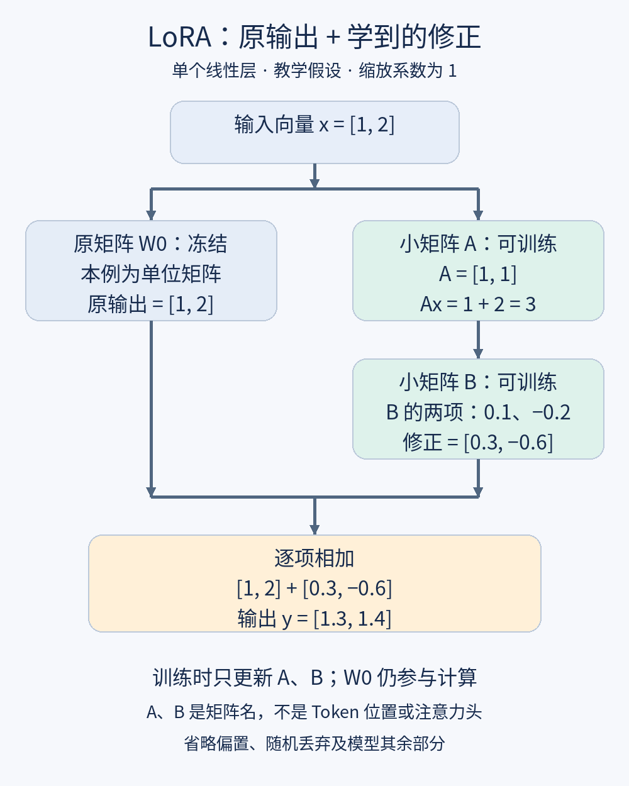

**第十六课｜LoRA：怎样只训练少量参数完成微调？**

2026年11月13日 · 阅读理解约8分钟，练习约2分钟

昨天讲了微调怎样更新参数，今天只追问：**能否保留原来的大矩阵，只训练一小组“修正参数”？**目前未见第十五课练习的新答案，先继续讲解，不把它记为已掌握。

**① 场景：为了一个任务，要调整整座模型吗？**

假设读书记录助手已经会理解中文，你希望它更稳定地区分“没读”和“没计时”。如果对整个模型做全参数微调，就需要为大量参数保存梯度、优化器状态等训练数据。

**LoRA，全称 Low-Rank Adaptation，中文为低秩适配**，提供了一种更节省可训练参数的办法：冻结原有权重，训练两块较小的矩阵，用它们产生对原计算的修正。[〔LoRA原论文〕](https://arxiv.org/html/2106.09685v2)

*LoRA learns a small update.*  
LoRA学习一个用少量参数表示的更新。

**② 类比：保留调音台，加一组联动旋钮**

想象一台调音台有很多旋钮。某项任务不一定需要逐个重新调整，而可能用少数“联动旋钮”，一起改变一组输出。

对应到LoRA：原参数保留，新参数学习怎样产生有用的改动。

类比的边界是：没有人事先规定某个旋钮专管“未知值”。这些改动仍是训练学出来的数字关系，而且少数联动方式也会限制能够表达的变化。

这里的**冻结（freeze）**，指训练时不更新那组参数，不代表跳过它的计算。

*We freeze the original weights.*  
我们冻结原始权重。

**③ 跟着图，亲手算一次**

只看一个线性层。它原本把输入向量 \(x\) 乘以权重矩阵 \(W_0\)，得到输出。矩阵可以先理解成按行列排好的数字表。

本课采用列向量写法；与以前写的 \(xW\) 只是约定不同，不能把两套写法中的矩阵直接混用。

LoRA加入两块矩阵 \(A、B\)：

\[
y=W_0x+B(Ax)
\]

左边是原计算，右边是修正量。这里的A、B是**矩阵名称，不是Token位置，也不是注意力头**。

以下数值全部是教学假设，展示一次前向计算，不是训练后实测。缩放系数设为1，省略偏置、随机丢弃及模型其他部分。

**第一步：原路径照常运行。**

设输入为 \(x=[1,2]^T\)，上标T在这里表示把这两个数竖着排列。令 \(W_0\) 为单位矩阵，即让输入保持原样：

\[
W_0x=[1,2]^T
\]

**第二步：A把两个数组合成一个数。**

设 \(A=[1,1]\)，所以：

\[
Ax=1\times1+1\times2=3
\]

**第三步：B把这个数变成两项修正。**

设 \(B=[0.1,-0.2]^T\)：

\[
B(Ax)=[0.1\times3,-0.2\times3]^T
=[0.3,-0.6]^T
\]

**第四步：逐项相加。**

\[
y=[1+0.3,\ 2-0.6]^T=[1.3,1.4]^T
\]

原矩阵没变，输出却变了，因为多了一条可训练的修正路径。得到的仍是中间向量，不是阅读分钟数或正确概率。

训练时，损失会通过这条计算关系产生梯度，优化器更新A、B。图中给出的A、B只是方便演示的一组值；不能凭输出变化就判断任务表现改善。

**④ “低秩”究竟限制了什么？**

**秩（rank）**描述矩阵中独立方向的数量。上例先把输入变成一个数，再乘以B，因此无论输入怎样变化，修正量都只能沿B所表示的方向伸缩。

这就是本例“秩最多为1”的直观含义。它限制的是**更新矩阵 \(BA\)**，并不是要求原矩阵 \(W_0\) 也只有一个独立方向。

*The rank limits the update.*  
秩限制了更新的表达范围。

若中间保留 \(r\) 个数，就能组合最多 \(r\) 个独立修正方向。r更大，表达能力上限更高，可训练参数也更多；效果是否更好仍需测试。

看一个尺寸账本：原矩阵输入、输出都是1000维。

|方案|需要训练的参数数目|
|---|---:|
|直接训练整个矩阵|1000×1000＝1,000,000|
|LoRA，r＝8|8×1000＋1000×8＝16,000|

这里仅计算这一个矩阵，不包含偏置和其他层。可训练参数为原来的1.6%，但原来的一百万个数仍然存在。

前面的二维例子中，A、B合计也是4个数，并没有节省参数；它用于方便手算。尺寸较大且r较小时，节省才明显。

**⑤ 为什么有用，又有哪些局限？**

LoRA尝试利用已有模型的能力，用受限制的更新适应任务；原论文的实验表明，某些任务可以用较低秩获得良好效果。这是经验依据，不是所有任务都只需要少量改动的保证。

训练得到的小参数集合常称为**适配器（adapter）**。它通常要配合兼容的基础模型使用，不能只拿一份很小的适配器文件，就当作完整语言模型运行。

*The adapter needs a compatible base model.*  
适配器需要兼容的基础模型。

在标准线性LoRA设置下，部署时也可以把 \(BA\) 加入 \(W_0\)，合并成新的矩阵；适用条件下便无需单独计算修正分支。[〔官方概念文档〕](https://huggingface.co/docs/peft/main/en/conceptual_guides/lora)

要避免三个误区：

- **冻结不等于不占资源。**基础权重仍要保存并参与计算，训练中的中间结果也要占显存。
- **LoRA不等于压缩整个模型。**它首先减少的是需要训练的参数；量化是另一个问题。
- **便宜不等于可靠。**错误标签、过拟合、过期资料和幻觉问题仍然可能存在。

它适合资源受限的任务适配，也便于保存多个任务的修正参数；如果问题只是最新公告没被读取，仍应先修检索流程。

**⑥ 两分钟开放式练习**

沿用图中的 \(W_0、A、B\)，把输入换成 \(x=[2,0]^T\)。

1. 算出A的输出、B给出的修正量，以及最终输出。
2. 有人说：“原参数冻结了，所以这不算训练。”你会怎样解释？
3. 如果想让修正量可以沿更多独立方向变化，你会考虑调整什么？代价是什么？

先自己想，再看参考。

---

**参考思路**

A的输出为 \(2+0=2\)；修正量为 \([0.2,-0.4]^T\)；原输出是 \([2,0]^T\)，相加得到：

\[
y=[2.2,-0.4]^T
\]

是否训练，要看有没有参数根据损失更新。LoRA中的A、B在训练，原权重冻结并不否定这一点。

可以考虑增加r，让更新有更大的表达空间；代价是可训练参数及相关训练开销增加，也不保证测试表现改善。

**⑦ 今天记住三条**

1. LoRA保留原计算，用两个可训练小矩阵产生修正量。
2. 低秩约束作用于更新矩阵；r控制其表达空间与参数规模。
3. 少训练参数不等于完整模型变小，也不等于结果一定正确。

下次第十七课：**《量化：把模型里的数字存得更省，会损失什么？》**

本课核实资料：

- [LoRA原始论文，第4节](https://arxiv.org/html/2106.09685v2)
- [Hugging Face：LoRA原理与权重合并](https://huggingface.co/docs/peft/main/en/conceptual_guides/lora)

完整正文、计算图与整理笔记已归档到[学习仓库](https://github.com/duanjiateng/ai-study/blob/main/originals/2026-11-13-16.md)。