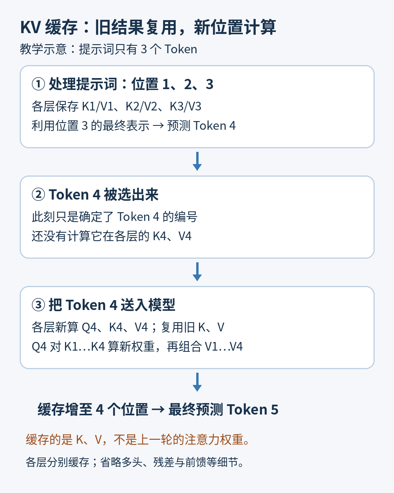

**第18课｜KV缓存：模型为什么不用每生成一个Token都重算全部历史？**

2026年11月15日 · 阅读理解约8分钟，练习约2分钟

今天掌握一个核心：**保存过去算好的K、V，让新位置继续使用；新位置的注意力仍要重新计算。** 标题中的Token是生成单位，不一定等于一个汉字。

先接上你的第16课答题：你对“冻结仍参与计算”和“增加秩不保证效果更好”的方向判断正确。数值题换成了输入[2,0]，因此Ax=2，修正量为[0.2,-0.4]，最终是[2.2,-0.4]；不能沿用旧输入算出的3。

**① 场景：已经读过的内容，还要反复读吗？**

你给AI一篇长文章，让它逐步写出摘要。生成下一个Token时，它仍要利用文章以及已经生成的内容。

一种直接做法是：每生成一步，就把越来越长的整段序列重新送进模型。这能工作，却重复计算了大量不变的内容。能不能保留这些结果，下一步接着用？

这就是**KV cache（Key–Value cache，键值缓存）**的用途。它保存注意力计算产生的K、V向量。英文可以这样记：*Reuse the cached keys and values.*——复用缓存的键和值。

**② 类比：资料卡保存下来，问题每次重新问**

想象你把资料整理成一叠卡片。每次有新问题，可以直接查卡片，不必重新制作整叠卡片；但仍要根据新问题，判断哪些卡片更相关。

对应到注意力：

- Q像本次查询，决定这一步怎样匹配信息。
- K用于与Q匹配，V提供被组合的信息。
- 缓存保留过去的K、V，下次继续使用。

类比的边界是：这些“卡片”实际是各层的数字向量，并不是人类可读的摘要。**缓存也不是把上一轮的注意力权重原样留下来。**

为什么旧向量能复用？今天讨论常见的因果Transformer推理：一个位置只能关注自己及前面的位置，不能看后面。这叫**causal attention（因果注意力）**。*A token cannot attend to future tokens.*——一个Token不能关注未来的Token。

因此，在模型参数、已有输入及位置等条件不变时，末尾追加Token不会反过来改变旧位置的计算结果。双向注意力不能直接套用这个理由。[来源：Transformer论文](https://arxiv.org/html/1706.03762v7)

**③ 逐步演示：三个Token，怎样继续生成？**

以下是教学示意。假设整个提示词只有位置1、2、3，暂不展开多头等细节。

**第一步：处理提示词，建立缓存。**

这一阶段叫**prefill（预填充）**：处理已经知道的输入，把各层对应的K、V存起来。提示词的多个位置可并行计算，但仍遵守因果限制。

完成后，每层都有位置1—3的K、V。模型根据位置3的最终表示预测下一个Token，选出位置4的Token。

注意：**选出Token4，只是确定了它的编号；还没有计算它在各层的K、V。**

**第二步：把Token4送入下一轮计算。**

逐步处理新Token的阶段叫**decode（解码）**。*Decode one token at a time.*——每次解码一个Token。

在某一层，模型为位置4计算新的Q4、K4、V4：

1. 取出缓存中的K1—K3、V1—V3。
2. 加上新算的K4、V4。
3. 用Q4与K1—K4匹配，算出这一步的注意力权重。
4. 按这些新权重组合V1—V4。

各层分别做对应计算；经过后续处理，模型预测Token5。**每层有自己的缓存，不能把第一层的K、V拿去替代所有层。**[来源：缓存说明](https://huggingface.co/docs/transformers/cache_explanation)

**第三步：看一次具体组合。**

为便于手算，假设某层某头的V都只有一个数：

|位置|V的值|来源|
|---|---:|---|
|1|2|缓存|
|2|4|缓存|
|3|6|缓存|
|4|8|本轮新算|

假设Q4与各K匹配后得到权重[0.1,0.2,0.3,0.4]。这组权重是教学给定，不是实际模型测量值。

注意力输出为：

\[
0.1\times2+0.2\times4+0.3\times6+0.4\times8=6
\]

到了位置5，即使旧V不变，新的Q5也可能产生不同权重。**复用资料，不等于复用“这次该怎样组合资料”的结果。**

**④ 究竟省了哪些计算？**

只统计每层需要新计算K、V的Token位置数，比较三次前向计算：

|要预测的位置|每次重算整个前缀|使用缓存|
|---|---:|---:|
|4|3|3|
|5|4|1|
|6|5|1|
|合计|12|5|

这里的12和5只是一个计算项目的计数，**不能直接说速度提高了12÷5倍**。

新位置仍要经过模型各层，计算自己的Q/K/V、前馈网络等；对于完整历史注意力，还要读取旧K、V并与历史位置交互。上下文变长，单步工作量仍可能增加。

代价则是占用存储空间：保留完整历史的KV缓存通常随Token数增长，多层、多请求也会增加开销。这也接上上一课：模型权重的存储量，不等于运行时全部显存需求。[来源：推理优化](https://huggingface.co/docs/transformers/llm_tutorial_optimization)

**⑤ 三个容易混淆的地方**

**缓存不是训练。** 保存K、V没有通过梯度更新模型权重，也不意味着模型永久学会了这段文章。

**缓存不是永久聊天记忆。** 它服务于计算复用，能否跨请求保留取决于系统实现；聊天记录存在，也不代表其缓存仍在。

**旧缓存并非随时有效。** 如果改了前面一句话，后面的表示可能依赖它，不能照搬原来的整份缓存。相同前缀可以在满足条件时复用；改动位置及受影响的后缀需要重新计算。更换模型参数也需要重新判断缓存有效性。

它适合加速连续生成和长上下文问答，但不会增加事实证据，也不会自动消除幻觉。

**⑥ 两分钟小练习**

某提示词有4个Token。预填充已经完成，模型刚选出Token5，尚未把它送入下一轮。

请用自己的话回答：

1. 此时每层缓存有几个位置的K、V？为了预测Token6，接下来新算哪个位置的K、V？
2. 同事说：“旧V没变，所以直接沿用上一轮注意力权重就行。”哪里不对？
3. 如果把提示词开头的“周六”改成“周日”，能否直接复用原来的整份缓存？为什么？

先独立想一遍，再看参考。

---

**参考思路**

1. 缓存有位置1—4。下一轮输入Token5，计算它在各层的K、V，缓存扩至5个位置，再预测Token6。刚选出一个Token，不等于已经计算过它的表示。
2. 当前Q变了，可关注的位置也增加了，需要重新计算权重；旧V能复用，旧权重不能据此直接复用。
3. 不能。修改可能改变分词及后续位置的表示；只能在条件一致时复用未变的前缀，并重算受影响部分。

**⑦ 今天记住三条**

1. KV缓存保存各层过去算出的K、V，减少重复计算。
2. 新Token仍要计算自己的表示，并用新的Q重新组合信息。
3. 缓存用存储换计算；它不是训练、永久记忆或正确性保证。

下次第19课：**《多模态：图片怎样进入语言模型？》**从图片被怎样表示开始，连接你已经学过的向量与注意力。

本课核实的一手资料（2026年11月15日查阅）：

- [Transformer原始论文：因果限制与注意力](https://arxiv.org/html/1706.03762v7)
- [Hugging Face：缓存怎样工作](https://huggingface.co/docs/transformers/cache_explanation)
- [Hugging Face：推理速度与内存优化](https://huggingface.co/docs/transformers/llm_tutorial_optimization)

完整讲义、图片与答题反馈已归档至[学习仓库](https://github.com/duanjiateng/ai-study)。