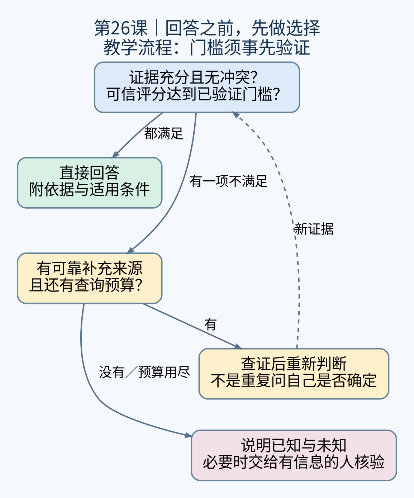

**第26课｜选择性回答：什么时候直接答，什么时候查证或交给人？**

今天约8分钟阅读、2分钟练习。核心是：**让系统同时决定“回答什么”和“这次是否适合直接回答”。**你会算两个指标，并用它们检查一个看似更可靠的助手。

第25课讲了置信度校准，目前未见你提交该课练习。今天接着把概率用于决策，不预设你已经掌握。

**① 同一个助手，三种不同处境**

你问活动几点开始。第一张海报时间清晰，且与最新公告一致；第二张海报模糊，但有官网可查；第三张海报与官网互相矛盾，工作人员才知道最终安排。

合理动作依次可能是：直接回答、先查证、说明冲突并交给工作人员确认。三个场景不应统一处理成“大胆猜一个”，也不应统一回复“不知道”。

**② 类比：给答案增加一道放行检查**

可以把模型想成写好稿子的编辑，旁边再有一道检查：这份稿子现在能发吗？

技术上，这叫 **selective prediction（选择性预测）**。系统既有产生候选答案的部分，也有选择是否输出的规则；规则可以依据可信评分、输入特征或另一个学习出来的判断器。选择器不一定是一套独立大模型。相关研究把“少覆盖一些输入”和“降低已接受预测的错误率”一起考虑。[〔来源1〕](https://arxiv.org/abs/1705.08500)

当条件不满足时，系统可以 **abstain（暂不作答）**，即不把候选结论作为确定答案交付。这不等于停止帮助：查资料、请求补充或转人工，都是后续处理方式。

*The model can abstain when evidence is missing.*——缺少证据时，模型可以暂不作答。

类比的边界：这道检查也会错，不能像“合格证”一样保证事实正确。它只是经测试后，用来改善整体决策的机制。

**③ 看图：暂不作答以后，仍然可以继续推进**

从顶部读：有依据、无冲突，并且满足已经验证的放行条件，才直接回答。否则，判断能否取得新证据。

虚线表示“查到资料后重新判断”。每次查询都消耗预算，所以不会无限循环。这是本课设计的教学流程，省略了来源权限等工程细节，并非所有系统都使用同一套规则。

这里的 **threshold（阈值）**，就是决定放行与否的分数门槛。例如可信评分达到0.8才放行。0.8只是候选设置，不能因为数字看着稳妥就直接使用；它也不自动等于80%的事实正确率。

**④ 具体算例：少答之后，真的更好吗？**

假设我们用固定的20道活动资料题评测助手。先在开发数据上确定规则，再到这批未参与调整的题上测试。下表全是教学数字：

|规则|直接回答数|其中错误数|覆盖率|已回答部分错误率|
|---|---:|---:|---:|---:|
|全部回答|20|5|100%|25%|
|较宽松门槛|16|3|80%|18.75%|
|较严格门槛|10|1|50%|10%|

第一步，计算 **coverage（覆盖率）**：直接回答数÷总题数。严格规则为10÷20＝50%，意味着一半问题仍要走其他处理流程。

第二步，计算 **selective risk（选择性风险）**。本课用已回答部分的错误率衡量：1÷10＝10%。分母是10，不是20；写成1÷20＝5%，会把没回答的题也拿来稀释风险。

第三步，同时比较两个指标。严格规则从原来的15个正确答案中留下9个，挡住了4个错误，也挡住了6个原本能答对的答案。**减少错误有代价：更多问题需要查证、等待或人工处理。**

如果目标是“已回答部分错误率不超过10%，并尽量多回答”，表内严格规则在这批样本上符合要求。但仅10个已回答样本远不足以证明长期风险始终低于10%，还需要更多独立测试及不确定性分析。

为什么这种方法可能有效？因为可信评分若能把容易错的题排得更靠后，筛掉低分部分就能留下较可靠的答案。若评分排序很差，提高门槛也不保证错误率下降；表里的改善不能当成必然规律。

**⑤ 怎样避免变成“一律不知道”？**

把所有题都拒绝，覆盖率就是0；此时已回答部分的错误率分母也是0，应记为无法计算，不能宣称“零错误、完美系统”。

部署时，还要检查被转走的问题后来有没有解决、等待多久、人工负担多大。转人工也不保证正确，应把冲突来源和缺失信息一起交过去，让接手的人有条件核验。

放行标准也要适应任务：把活动主题分错与把开始时间报错，后果不同，不能机械使用相同门槛。

还有上课提到的数据变化问题：在清晰海报上有效的评分，遇到模糊扫描件可能失灵。选择性问答研究也发现，在偏离训练数据的输入上，单靠模型自身概率做选择可能表现不佳，因此需要针对新类型数据验证。[〔来源2〕](https://aclanthology.org/2020.acl-main.503/)

这些机制适合资料问答、信息提取等允许查证或人工接手的任务。关键是把可回答部分继续完成，同时清楚标出未解决部分。

**⑥ 两分钟小练习**

教学测试共有30题：规则甲直接回答24题，其中错3题；规则乙直接回答15题，其中错1题。产品暂定要求：已回答部分错误率不超过10%，覆盖率至少60%。

请回答：

1. 甲、乙各自的覆盖率和已回答部分错误率是多少？是否有规则同时达标？
2. 如果都没达标，你会怎样改进，而不是只把门槛继续提高？
3. 某题评分0.95，但两个有效来源给出不同开始时间。你会直接回答、查证，还是交给人？说明条件。

先独立想一想，再看参考。

---

**参考思路**

甲：覆盖率24÷30＝80%，错误率3÷24＝12.5%；乙：覆盖率50%，错误率约6.67%。**两者都没有同时满足要求。**

可以改进证据检索、冲突识别、评分排序或模型本身，再用独立新题验证；也可测试其他门槛，但不能假定一定有满足双重要求的门槛。

0.95不能压过证据冲突。先核对日期、版本和适用范围；有可靠新来源且预算允许就查证。仍无法解决时，说明冲突并交给掌握信息的人确认，不擅自选一个时间。

**⑦ 三条要点**

- 选择性回答增加的是放行决策，通常不需要每次修改生成模型参数。
- 覆盖率与已回答部分错误率要一起看；少答不自动等于服务更好。
- 暂不下结论之后，应有查证、明确未知或人工接手的路径与停止条件。

下次第27课：**《测试集泄漏：为什么练习题做得很好，上线却失灵？》**随后第28课用新案例复习22—27课。

一手资料（2026年11月23日核实）：

- [Geifman与El-Yaniv，Selective Classification for Deep Neural Networks，2017](https://arxiv.org/abs/1705.08500)
- [Kamath等，Selective Question Answering under Domain Shift，2020](https://aclanthology.org/2020.acl-main.503/)