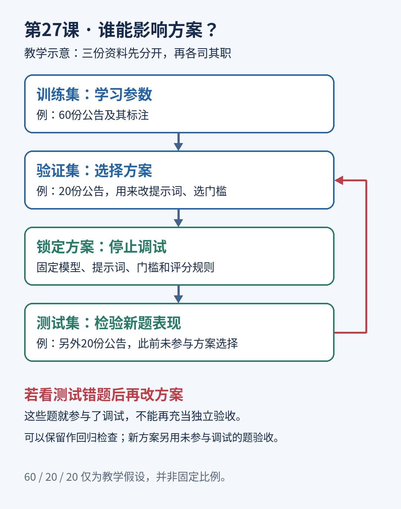

**第27课｜测试集泄漏：为什么练习题做得很好，上线却失灵？**

今天用约8分钟阅读、2分钟练习，掌握一个核心：**用来证明效果的题，一旦参与了方案调整，就不再是独立的验收依据。**

先接上你的第26课答案：甲、乙的覆盖率和错误率都算对了，也正确判断两者均未同时达标。“提高覆盖率、降低错误率”是目标；具体可以改善检索或判断难易的能力，再用独立新题验证。今天就讲这个“独立”为什么重要。

**① 从一个看似成功的改进开始**

活动资料助手原来做20道题，只答对14道。开发者查看错题，反复改提示词，终于答对18道，于是宣布：“准确率从70%提高到90%，可以上线了！”

旧题确实进步了。但新用户会问新的活动、新的时间条件。**18÷20只说明这个版本在这20道熟题上的成绩，不能直接证明面对新题也有90%的准确率。**

这里没有算术错误，问题出在这份成绩所代表的范围。

**② 类比：拿模拟卷练习，再把同一张卷子当考试**

学生看答案、订正、重做，得分上升很正常。但这张卷子已经参与了学习，再考一次无法充分检验举一反三。

模型评估也有类似问题。**Data leakage，数据泄漏**，指本应隔离的信息通过某条路径进入了训练或方案选择，导致评估可能过于乐观。今天聚焦测试信息泄漏，而不是隐私外泄。官方文档特别提醒：不仅直接训练，预处理等环节也可能引入泄漏。

类比的边界是：系统不必像人一样“记住答案”。开发者只看测试分数来挑提示词、选门槛，也会让方案逐渐适应这套题的特点。反复依据留出数据调整分析，会增加对留出数据本身过拟合的风险。

**③ 三份题，各自承担什么任务？**

假设我们准备100份不同活动的公告，每份配好问题及核验过的答案：

| 资料 | 本例数量 | 主要用途 |
|---|---:|---|
| training set，训练集 | 60份 | 训练时更新模型参数 |
| validation set，验证集 | 20份 | 比较方案、修改提示词、选择门槛 |
| test set，测试集 | 20份 | 方案锁定后，检验未参与调试的题 |

60／20／20只是教学假设，并非固定比例。若只做提示词优化，可以不进行参数训练，但仍应区分“调试用题”和“最终检验用题”。这种分工让方案选择与最终评估尽量分离。

读图：向下箭头表示工作阶段，不是把同一批题依次改名。右侧红箭头表示测试反馈又影响了方案；发生这件事后，新版本需要新的独立验收。

英文可以这样说：*Keep the test set separate.*——把测试集单独保留。

**④ 逐步检查：70%变90%，究竟证明了什么？**

继续开头的假设例子：

**第一步：初次测试。** 固定模型和提示词，在未用于调试的20题上答对14题，得到70%。这仍只是小样本估计，不是上线保证。

**第二步：查看错题并改提示词。** 发现“费用未公布”经常被写成0，于是加入具体规则，甚至把错题的正确回答作为示例。这能帮助修复问题，但旧测试题已经影响了方案。

**第三步：重测旧题。** 18题正确，得到90%。可以报告“旧案例修复后的通过率为90%”，可以保留这些题检查错误是否重现；不能把它包装成独立新题成绩。

**第四步：重新验收。** 锁定新方案，另取20道此前未参与调试、符合目标使用场景的新题。假设答对13道，即65%。这提示旧题成绩不足以代表新题表现；但不能仅凭两组小样本，就断言模型变差或把全部差异归因于泄漏——题目难度与抽样波动也可能不同。

我们真正关心的是 **generalization，泛化**：面对未参与开发的新案例，仍能完成任务。若要比较新旧版本，应让两者在同一份独立新测试集、相同条件下接受评估。

**⑤ 最隐蔽的情况：文件不同，题目其实同源**

把同一张活动海报改写成五种问法，再随机分到训练集和测试集，文件名虽然不同，关键日期、对象和答案却高度重合。若目标是处理新活动，这种划分就可能高估能力。

更合适的做法是先按原始活动分组，让同一活动的改写题留在同一组，再划分用途。官方文档也强调：要评估对新群组的泛化，就应避免同组样本横跨训练和验证边界。

注意两个局限：独立测试不能消除小样本误差，也不能保证未来场景不变；上线下降还可能来自资料变化、工具故障等原因，不能一看到下降就断定泄漏。

测试后可以分析错误、继续改进。需要改变的是这些题的身份：它们可以成为开发资料，下一版再用未参与开发的数据检验。

**⑥ 两分钟小练习**

你负责一个公告问答助手：

- 团队查看30道测试题的错误，改了10轮提示词，最后答对28道，宣布“新问题准确率93.3%”。
- 每张原公告生成5种改写题，然后把所有题随机分进开发集和测试集。

请用自己的话回答：

1. 这里有哪两条信息泄漏路径？
2. 28／30这个成绩还能说明什么？不能说明什么？
3. 如果预算只够新增20份公告，你会怎样安排下一次验收，避免它们再次变成调试题？

先自己想，再看下面。

---

**参考思路**

一条是测试错误反复指导提示词修改；另一条是同一公告的近似题跨越分组边界。

93.3%可以作为这批已参与调试案例的通过率，不能直接当成新问题准确率。

先用旧案例完成调试并固定方案、评分标准，再用来自新活动的20份公告验收；同一公告的改写题一起保留。如果看完结果又继续修改，就为下一版另准备独立验收题。20份仍然偏少，报告结果时应保留样本量和适用范围。

**⑦ 今天记住三点**

1. 测试是否独立，取决于信息有没有影响方案，不取决于文件名叫不叫“测试集”。
2. 没改模型参数，也可能通过改提示词、选门槛而适应测试题。
3. 旧题适合查修复，新题用于验收；同源改写要按组划分。

下次第28课，用一个“活动问答助手上线验收”案例复习第22—27课，把蒸馏、偏好、奖励、校准、选择性回答和独立测试连接起来。

本课资料已于2026年11月24日核实：

- [scikit-learn：数据泄漏与防范](https://scikit-learn.org/stable/common_pitfalls.html#data-leakage)
- [scikit-learn：验证、测试与分组划分](https://scikit-learn.org/stable/modules/cross_validation.html)
- [原始论文：Generalization in Adaptive Data Analysis and Holdout Reuse](https://arxiv.org/abs/1506.02629)
