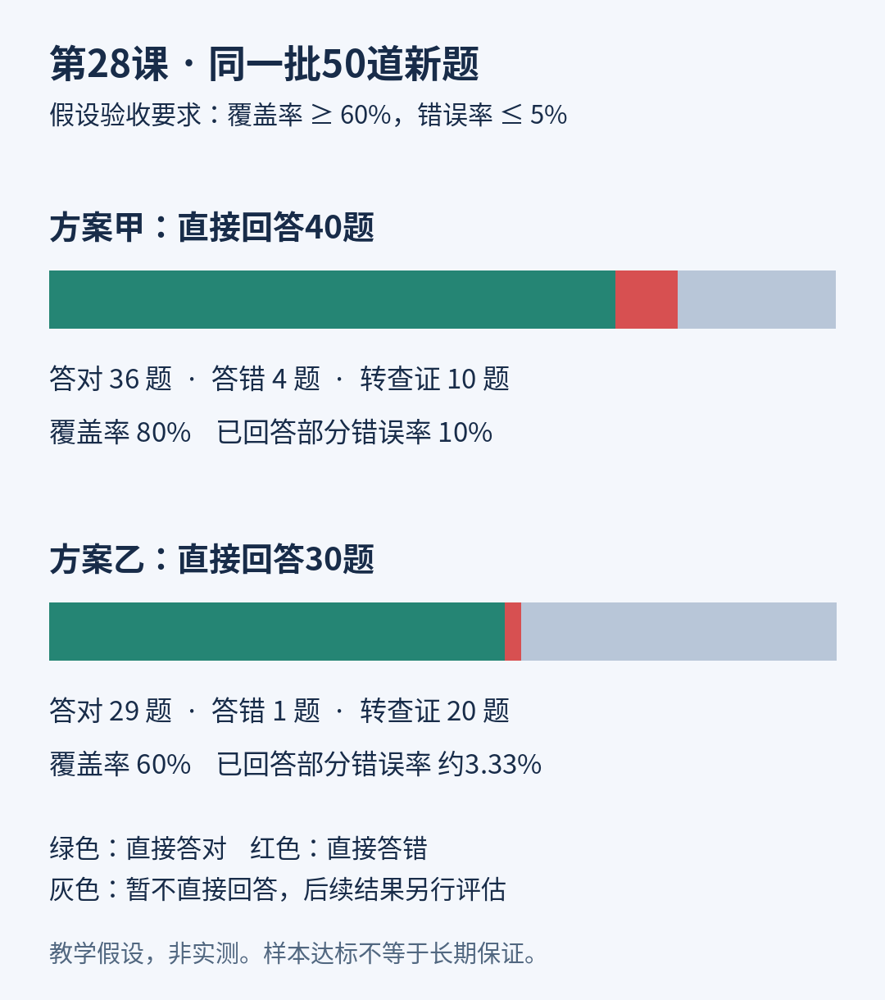

**第28课｜综合复习：活动问答助手上线前，怎样证明它值得信任？**

今天约8分钟阅读、2分钟练习。用一个新案例复习第22—27课，只围绕一个核心：**把“模型看起来更好”，变成有明确范围、能够复查的验收结论。**

昨天你正确指出旧题成绩不能外推新题，并提出保留独立题。补充的边界是：同源题跨开发与测试分组才有泄漏风险；10题中每错一道，成绩就变化10个百分点。今天继续练习怎样判断证据够不够。

**① 场景：三个好消息，足够上线吗？**

一家社区中心准备上线活动助手。团队说：

- 小模型已经学过大模型的回答，运行更省。
- 新回答在比较中更受欢迎。
- 模型经常说“我有90%的把握”。

这些消息各有价值，但尚未回答用户最关心的问题：**活动时间是否准确？资料不全时是否会编造？能解决多少问题？**

本课所有活动、数量和验收要求均为教学假设，不对应真实产品测试。

**② 类比：出厂检查不能只看一张奖状**

把助手想成一台待验收的机器。“学过优秀样本”说明制造过程；“更受欢迎”说明某种评价；“我很有把握”是机器自己报告的状态。我们还需要实际检查它在目标任务中的表现。

类比的边界：AI的成绩依赖题目、资料和使用条件，不能凭一次验收得到永久合格证。我们要保留的，是从目标、测试到结论的依据。

例如先规定：在给定公告范围内，直接回答应覆盖至少60%的问题，其中错误率不超过5%；转去查证的问题另查解决情况。这些是本例的要求，不能当作所有应用的通用标准。

**③ 第一关：它学了什么，评分又奖励了什么？**

第22课的 **distillation（蒸馏）**，让学生模型利用教师输出学习自己的参数。原始研究展示了把较复杂模型的知识转移到更易部署模型的思路；这项训练过程本身不等于学生已经通过新任务验收。

假设教师把“报名费用尚未公布”写成“免费”。学生学得越像，可能越稳定地重复错误。你此前说“教师也会错，需要重新打标”，方向正确；还要处理与新标签冲突的教师训练信号。

接着复习第23、24课。对于同一份公告：

- 甲：“免费，欢迎直接参加！”
- 乙：“费用尚未公布；公告要求提前报名。”

若比较标准偏爱热情、简短，甲可能获高分。但本任务应优先奖励有依据且完整的回答。**Reward（奖励）**只是训练或筛选所用的分数；分数高不自动代表目标完成。

你曾提出“不确认应给低分”，这里要按条件拆开：公告明明写着开始时间，却拒绝回答，应扣分；费用确实未公布，明确说未知并提示确认途径，可以是好回答。

**④ 第二关：用同一批新题，把数字算清楚**

团队先用开发资料确定甲、乙两套完整方案，再锁定模型、提示词与放行条件，在同一批50道独立新题上测试。题目按原活动分组，未参与调试；资料与工具条件保持相同。

反复根据测试结果调参会影响评估的独立性，因此方案选择与最终测试需要分开。

读图：两条横条总长都代表50题。灰色不是“答对”，而是暂未直接作答，后续结果还要检查。

先算 **coverage（覆盖率）**：

甲：40÷50＝80%；乙：30÷50＝60%。

再算已回答部分错误率：

甲：4÷40＝10%；乙：1÷30≈3.33%。

按预先要求，甲的错误率不达标；乙在这批样本上同时达标。注意乙直接答对29题，甲直接答对36题：乙少犯错，但也把更多问题留给了查证流程。

因此准确结论是：“乙在这50题上满足两项要求。”不能直接升级为“乙全面更好”或“长期错误率一定低于5%”。尤其乙只答了30题，样本仍少。

**⑤ 第三关：信心与后续服务，也要接受检查**

再看第25课的 **calibration（校准）**：报告的概率，应与相应分组里的实际正确比例匹配。这与单纯提高答对率是不同目标。

在另一批专门检查置信度的题中，假设乙有10个直接答案都报告90%把握，实际7题正确。这组观察正确率是70%，比报告值低20个百分点，提示可能过度自信；10题太少，还需要更多样本验证。

把90%改成70%，不会把那3个错误答案改对。如果调整后的评分又改变放行决策，整个回答系统的覆盖率和错误率才可能随之变化，并需要重新评测。

*High confidence is not proof.*——高置信度不是证据。

乙还有20题转去查证。若其中8题最终找到可靠依据、12题仍未解决，应分别记录；查证后新给出的答案也要核验，不能把“调用过搜索”当作解决。

这套验收方法适合资料问答、信息提取等任务。但上线后的新公告类型、模糊图片或工具异常，仍可能改变表现。若甲乙同时改变了多项设置，测试能比较最终方案，却不能直接确定是哪项改动造成差异。

**⑥ 两分钟练习：你会签字通过吗？**

另一组独立测试有40题。新方案直接回答28题，其中错2题；剩余12题进入查证。要求仍是覆盖率至少60%、已回答部分错误率不超过5%。

其中10个直接答案都报90%把握，只有8个正确。团队打算查看错题、修改提示词后，再用这40题证明新版本达标。

请回答：

1. 两项指标是多少？当前方案是否同时达标？
2. 把90%改成80%，是否就修复了回答错误？你还想检查什么？
3. 修改提示词后，这40题还能承担什么用途？下一轮验收怎样安排？

先自己计算，再看参考。

---

**参考思路**

覆盖率28÷40＝70%；错误率2÷28≈7.14%，因此没有同时达标。

80%与这10题的观察正确率相符，但修改数字没有纠正答案，也不能凭这小组保证后续校准。还应检查错误原因，以及12题查证后的解决率和答案质量。

旧题可用于调试和检查错误是否重现。新版本锁定后，用未参与调整的新活动题验收，同源改写放在同组；必要时增加样本，再比较覆盖率、错误率与后续处理结果。

**⑦ 三条要点**

1. 学过好老师、偏好分高、报告有把握，都需要独立任务结果来检验。
2. 覆盖率、已回答错误率、校准和后续解决情况，分别回答不同问题。
3. 验收结论要带上样本与条件；测试题参与改进后，新版本需要新的独立证据。

下次第29课：**《重排序：已经搜到资料，为什么还要再排一次？》**回到检索技术，用具体例子解释怎样把真正有用的证据排到前面。

一手资料（2026年11月25日核实）：

- [Hinton等：Distilling the Knowledge in a Neural Network](https://arxiv.org/abs/1503.02531)
- [Guo等：On Calibration of Modern Neural Networks](https://arxiv.org/abs/1706.04599)
- [scikit-learn：模型选择与独立评估](https://scikit-learn.org/stable/modules/cross_validation.html)
