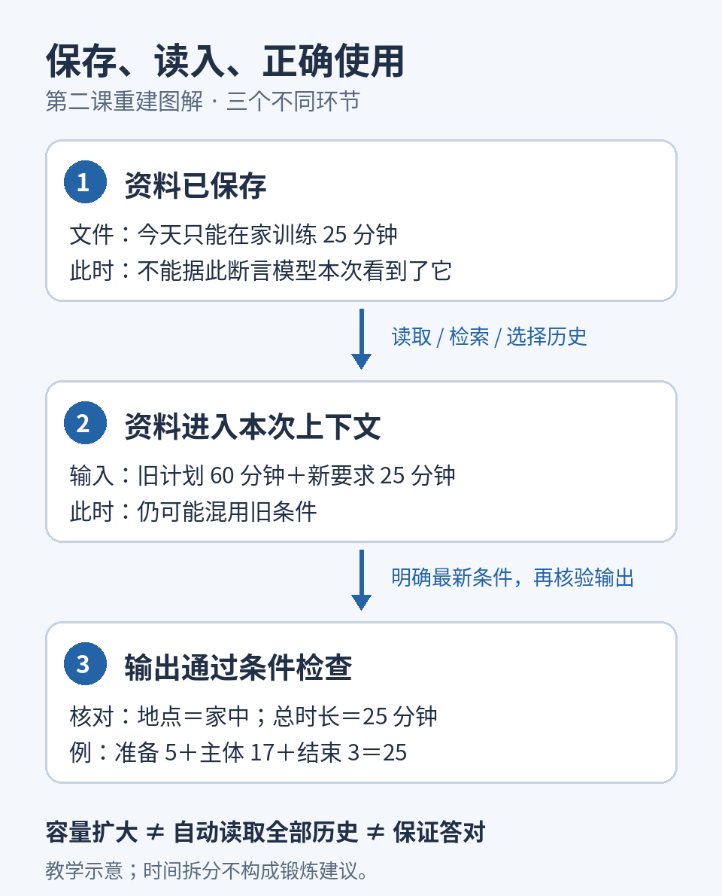

# 第2课｜Token与上下文窗口：为什么长对话会漏掉信息？

> **重建版说明：**按用户授权，根据已确认的第二课主题和教学范围重新编写，供补档与阅读；不是历史原文的逐字恢复。原课日期为2026-10-30。本次图解亦为新制作。历史截图和两分钟复习仍独立保留，学习进度与练习完成状态不因补档改变。

阅读理解约8分钟，练习约2分钟。今天掌握一个核心区别：**资料被保存、进入本次上下文、被正确使用，是三件事。**

## ① 聊过的内容，为什么还会忘？

假设你前面说“今天只能在家训练25分钟”，聊了很多其他内容后，AI又安排了健身房60分钟方案。

这可能有两类原因：新条件没有进入这次计算；或者它已经在输入中，模型却混用了旧条件。两种情况都像“忘了”，补救方法却不同。不能仅凭一次错误，就认定对话超出了窗口。

## ② 先认识计量单位：Token

**Token（词元）**是模型处理文本的基本单位。**Tokenizer（分词器）**负责把文本切成这些单位，并映射为编号。一个Token可能是一个词、词的一部分或其他文本片段；它不固定等于一个汉字。

因此，中文、英文、数字和符号即使字符数相同，Token数量也可能不同。准确计数需要使用对应模型的分词器，不能套用统一的“一个字等于几个Token”。Hugging Face文档展示了不同切分方式如何把同一个词拆成不同片段。[1]

这里的**Context window（上下文窗口）**，可以先理解成模型一次计算可容纳的上下文长度上限，通常以Token计量。它描述容量，不代表系统会自动装入全部聊天记录。

> The file is saved, but it is not in the current context.  
> 文件已保存，但没有进入当前上下文。

## ③ 类比：文件柜与办公桌

把历史聊天、文档看成文件柜，把本次上下文看成办公桌。柜子可以放很多资料，但每次工作，系统只会拿出一部分放上桌。

桌面可能包括系统要求、选中的历史消息、你的当前问题，以及工具返回的资料。聊天界面里能翻到一条旧消息，不意味着这次模型输入包含它的全文。

这个类比只解释信息范围：模型没有人的记忆体验；上下文是数字化输入，处理信息也不是逐页翻纸。文件柜里的资料要通过实际读取或检索进入输入，才有机会参与回答。[2]

## ④ 具体算一次：8000 Token怎么分？

**以下完全是教学假设，不对应任何当前产品。**假定一个系统允许输入与新增输出共占8000 Token，并为回答预留1500 Token。

|内容|假设Token数|
|---|---:|
|系统要求|500|
|选中的聊天历史|3000|
|读取的资料|2000|
|本次问题|500|
|输入合计|6000|
|预留回答|1500|
|剩余空间|500|

预算是：

**8000－6000－1500＝500**

现在再塞进一份2000 Token的资料，输入加预留输出就变成9500，超出1500。系统需要减少输入、压缩内容、调整输出预算，或拒绝这次请求；具体行为取决于实现。

预留1500不代表模型一定生成1500。真实系统还可能分别限制最大输入、最大输出，并有额外计数规则；这里只说明输入和回答会争用有限容量。

**第一种处理：截断。**  
**Truncation（截断）**指删去部分输入。有的系统删除较早消息，有的按其他规则选择；不能假定所有聊天产品都相同。如果“今天25分钟”被排除，本轮就无法直接依据那条原话作答。

**第二种处理：摘要。**  
**Summary（摘要）**用较短文本保留重点。例如把多轮交流压成“用户希望居家训练”。它省空间，却可能遗漏“今天只有25分钟”，甚至丢掉“无器械”等限定。摘要是一种有损压缩，不能替代完整原稿。[2]

这也是我们同时保存完整讲义与整理笔记的原因：笔记方便快速了解进度，原文方便核查细节。

## ⑤ 没超窗口，也可能答错

假设输入同时包含：

> 旧计划：健身房，60分钟。  
> 最新条件：今天在家，25分钟，替代旧计划。

即使两条都进入窗口，模型仍可能沿用60分钟。此时问题发生在信息利用和约束执行，不能仅靠扩大窗口解决。

《Lost in the Middle》在所测试的模型和任务中发现，相关信息在长输入中的位置会影响表现，中间位置的信息有时更难被有效利用。[3] 这不是所有模型的固定规律，也不是“放到最后就一定正确”的保证。

处理长对话时，可以保留一张简短的“当前条件卡”：写明日期、现行要求、被替代的旧要求，以及需要核验的结果。例如：

> 适用日期：2026-10-30。当前地点为家中，总时长25分钟。此前健身房60分钟方案失效。请列出各段时间并检查合计。

清楚的版本信息减少歧义；核算输出才能检查条件是否真的执行。仅让AI回复“我记住了”，不足以证明后续答案会正确。

对长期资料，可外部保存并按需检索；对多份冲突记录，应核对日期和来源；对要求完整统计的任务，则要确认记录找齐。检索能补充输入，但不能保证没有漏查。

## ⑥ 两分钟开放式练习

给下面两种情况各写一句补救指令，并说明你正在解决哪一环的问题：

**A：**文件中写着“今天只能在家训练”，系统没有读取该文件，却给出健身房方案。

**B：**模型收到“旧计划60分钟”和“今天改为25分钟”，仍安排了60分钟。

再想一步：为什么B不能仅靠“换一个更大窗口的模型”保证解决？

先写下自己的答案，再看下面。

---

**参考思路**

A可以说：“请先读取文件中的今日条件，列出地点和时间，再据此安排；读不到请说明。”如果不方便读取，也可直接补入关键条件。这解决的是信息未进入本次上下文。

B可以说：“以今天25分钟为最新条件，覆盖旧60分钟计划；逐项列出分钟数，并计算总和。”这解决版本混用与执行失败。比如5＋17＋3＝25，只验证时间，并不代表其他要求已满足，也不是锻炼处方。

B中的信息已经在输入中，更大的容量不能直接保证更准确的使用。仍需明确条件并检查结果。

## ⑦ 今天带走三点

1. Token不是固定字数；上下文窗口有容量限制。
2. 保存、读入和正确使用是不同环节，先判断问题发生在哪里。
3. 摘要可能遗漏条件；重要信息保留日期与原文，输出还要核验。

**课程顺序中的下一课：**第3课《Embedding：AI怎样把文字变成可比较的数字？》。本次是第二课补档，不改变已经推进到第11课结束的实际学习进度。

**本次重建核实的一手资料**

1. [Hugging Face：Tokenization algorithms](https://huggingface.co/docs/transformers/main/en/tokenizer_summary)
2. [Anthropic：Effective context engineering for AI agents](https://www.anthropic.com/research/effective-context-engineering-for-ai-agents)
3. [原始论文：Lost in the Middle](https://arxiv.org/abs/2307.03172)

历史来源另见：[第二课截图](../originals/2026-10-30-02-screenshot.md)、[两分钟复习原文](../originals/2026-10-30-02-review.md)。
